# Архитектура — ANPR Parking Platform

**Статус:** фаза 1, 2026-09-19. Кода нет. Решения — `docs/adr/`, допущения — `docs/ASSUMPTIONS.md`, рамка — `docs/prompts/00-CORE.md` (Q1–Q9 отвечены).

## 0. Сводка решений

| ADR | Решение |
|---|---|
| [ADR-01](adr/ADR-01-modular-monolith.md) | Модульный монолит, один образ, роли процессов через `APP_ROLE`, границы модулей — AST-тест |
| [ADR-02](adr/ADR-02-two-db-pools.md) | Две роли БД `app_critical` (`remote_apply`) / `app_bulk` (`off`), два пула PgBouncer |
| [ADR-03](adr/ADR-03-access-control-context.md) | Access Control — отдельный контекст, `resolve()` одним запросом |
| [ADR-04](adr/ADR-04-access-cache-invalidation.md) | Кеш решений в Redis TTL 300 с + локальный 5 с, двойная инвалидация, N = 5 с |
| [ADR-05](adr/ADR-05-occupancy.md) | Occupancy — счётчик Redis как проекция, истина — активные сессии |
| [ADR-06](adr/ADR-06-vehicle-ownership.md) | `Vehicle` — в Parking, уникален на tenant |
| [ADR-07](adr/ADR-07-events-transport.md) | Outbox → Redis Streams, 8 шардов по `aggregate_id`, at-least-once |

Сквозные правила, которые не являются ADR, а следуют из CORE: транзакция БД никогда не содержит внешний HTTP (I-9) — все вызовы шлагбаумов и провайдеров происходят **после коммита** из Celery-задач или post-commit hook'ов; вся асинхронная работа запускается **только через outbox** (единый путь, без «быстрого» обходного).

---

## 1. C4

### 1.1 Context

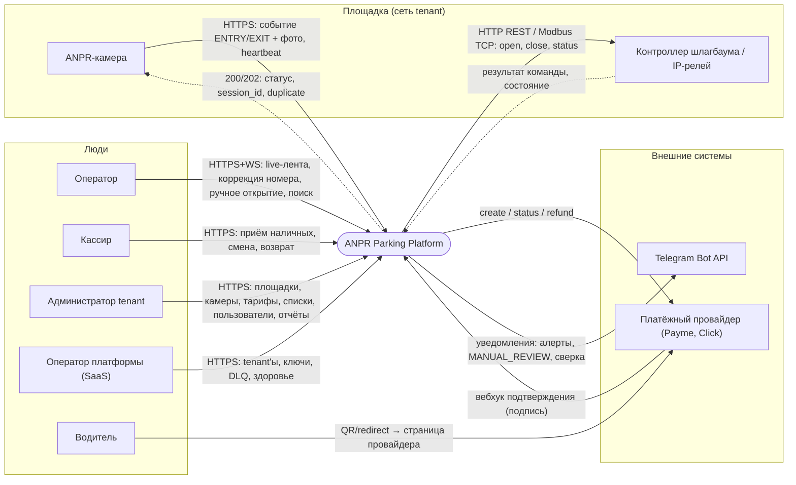

| Актор | Посылает | Получает |
|---|---|---|
| ANPR-камера | `ENTRY`/`EXIT` с номером, confidence, временем, фото (родной формат или нормализованный JSON); heartbeat | `200` статус/`session_id`/`duplicate`, `202 queued` в оффлайне, `401/422/429` |
| Контроллер шлагбаума | результат `open/close`, состояние стрелы | команды `open/close/status` с Bearer или Modbus-регистры |
| Оператор | коррекции номера с `reason`, ручное открытие с `reason`, закрытие orphan | live-лента (WS), очередь `MANUAL_REVIEW`, occupancy, здоровье устройств |
| Кассир | подтверждение наличной оплаты, открытие/закрытие смены, возврат наличных | сумма к оплате (с бэкенда), чек/квитанция, отчёт смены |
| Администратор tenant | конфигурация площадок, камер, ключей, шлагбаумов, тарифов, списков доступа, пользователей | отчёты, аудит, сверка |
| Оператор платформы | tenant'ы, ротация ключей шифрования, replay DLQ, ретеншен | системные дашборды, алерты |
| Водитель | оплату — только через провайдера (QR/redirect) или наличными кассиру | открытый шлагбаум; в системе напрямую не аутентифицируется |
| Платёжный провайдер | вебхуки с подписью, реестр для сверки | `create/status/refund` с `idempotency_key` |
| Telegram | — | уведомления операторам и дежурным |

### 1.2 Container

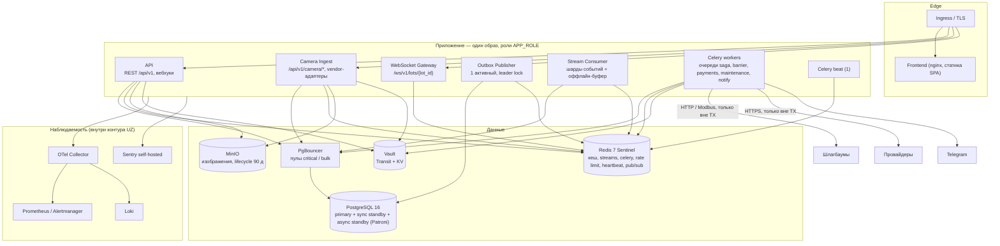

**Почему Camera Ingest — тот же образ, но отдельный Deployment.** Ingest использует те же модули `anpr`, `parking`, `access`, `tariff` in-process — вынести его в другой кодовый артефакт значило бы сетевой вызов внутри транзакции ENTRY. Но профиль трафика другой: 200–400 RPS с бюджетом p95 150 мс против операторских запросов и медленных вебхуков. Поэтому: один образ, `APP_ROLE=camera-ingest` монтирует только camera-роуты, отдельный HPA по RPS, отдельный пул PgBouncer (`critical`), отдельный ingress с аллоклистом сетей площадок, отдельная NetworkPolicy. Падение операторского API не трогает приём событий и наоборот.

| Контейнер | Назначение | Вход | Выход | Состояние | Масштабирование | При падении |
|---|---|---|---|---|---|---|
| **API** | REST для операторов/админов, вебхуки провайдеров, presigned URL | HTTPS от ingress | PgBouncer (`critical` и `bulk`), Redis, MinIO (presign), Vault (старт) | stateless; ключи tenant в памяти | ≥ 3 реплики, HPA по CPU и RPS | Операторы теряют UI; камеры и саги работают; вебхуки ретраятся провайдером |
| **Camera Ingest** | Приём событий и heartbeat, vendor-адаптеры, идемпотентность, ENTRY-транзакция, старт EXIT-саги, оффлайн-буфер | HTTPS от камер (аллоклист сетей) | PgBouncer `critical`, Redis (rate limit, кеш, streams), MinIO (put изображений vendor-адаптером) | stateless | ≥ 3 реплики, HPA по RPS (цель 100 RPS/под до замера фазы 8) | Камеры получают ошибки → площадка в ручном режиме; при живом Redis и мёртвом PG — 202 и буфер |
| **WebSocket Gateway** | Live-поток оператору | WSS от браузеров | Redis pub/sub (подписка), API (проверка токена — локально по ключу JWT) | соединения в памяти, состояние клиента в Redis | ≥ 2 реплики, без sticky | Клиенты переподключаются и перезапрашивают состояние (фаза 6) |
| **Outbox Publisher** | `outbox` → Redis Streams | `LISTEN outbox_new` + опрос 250 мс | `XADD events:{0..7}` | stateless; лидер через advisory lock | 1 активная + 1 standby реплика | События копятся в `outbox` (метрика лага, алерт > 5 с); ничего не теряется |
| **Stream Consumer** | Обработчики integration events; replay оффлайн-буфера в PG | `XREADGROUP` по шардам и `anpr:offline` | PgBouncer `critical`/`bulk`, Redis (occupancy, кеш, pub/sub → WS), Celery (постановка задач) | stateless; аренда шардов в Redis | ≥ 2 реплики, ≤ 8 активных (по числу шардов) | Лаг стримов растёт; occupancy и WS устаревают; сага не продвигается — алерт `redis_stream_lag` |
| **Celery workers** | `saga` (EXIT-сага), `barrier` (команды), `payments` (провайдеры, вебхуки, сверка), `maintenance` (ретеншен, флаш heartbeat, партиции, проверка бэкапов), `notify` (Telegram) | Redis broker | PgBouncer, шлагбаумы, провайдеры, Telegram — всё вне TX | stateless; задачи идемпотентны | ≥ 2 на очередь, по глубине очереди | Очередь копится; саги возобновляются при старте (таймауты шагов) |
| **Celery beat** | Расписание | — | Redis broker | lock в Redis | 1 | Периодические задачи не запускаются — алерт по «последнему успешному запуску» |
| **Frontend** | SPA, CSP-заголовки | HTTPS | API, WS | stateless | 2 | Оператор без UI; бэкенд работает |
| **PostgreSQL** | Единственный источник истины | PgBouncer, publisher | WAL → standby, pgBackRest | primary + sync + async | вертикально; чтение отчётов — async standby | См. failure matrix §5 |
| **PgBouncer** | Пулы `critical`/`bulk`, transaction pooling | приложение | PG | stateless | 2 (за Service) | Приложение теряет БД → circuit breaker → оффлайн-режим |
| **Redis** | Кеш доступа и ключей, streams, DLQ, Celery, rate limit, heartbeat, occupancy, pub/sub | приложение | — | AOF everysec | Sentinel 3 узла | Деградация: кеш мимо, буфер недоступен, Celery стоит → API честно 503 на camera-events при мёртвом PG и Redis одновременно |
| **MinIO** | Изображения, versioning, lifecycle 90 д | presigned PUT/GET, vendor-адаптер | репликация в второй бакет | distributed | 4 узла EC | Изображения не сохраняются — событие обрабатывается, `image_delivered=false`, повтор |
| **Vault** | KEK, DEK, HMAC-ключи, секреты (ESO) | приложение при старте, ротация | — | HA raft 3 | 3 | Работающие поды продолжают (ключи в памяти); новые поды не стартуют (I-14) — алерт |
| **Наблюдаемость** | Метрики, логи, трейсы, ошибки — все внутри контура (Q6) | OTLP, scrape | — | — | — | Слепота, не отказ: алерт `up == 0` |

### 1.3 Component

#### API (роли `api` и `camera-ingest`)

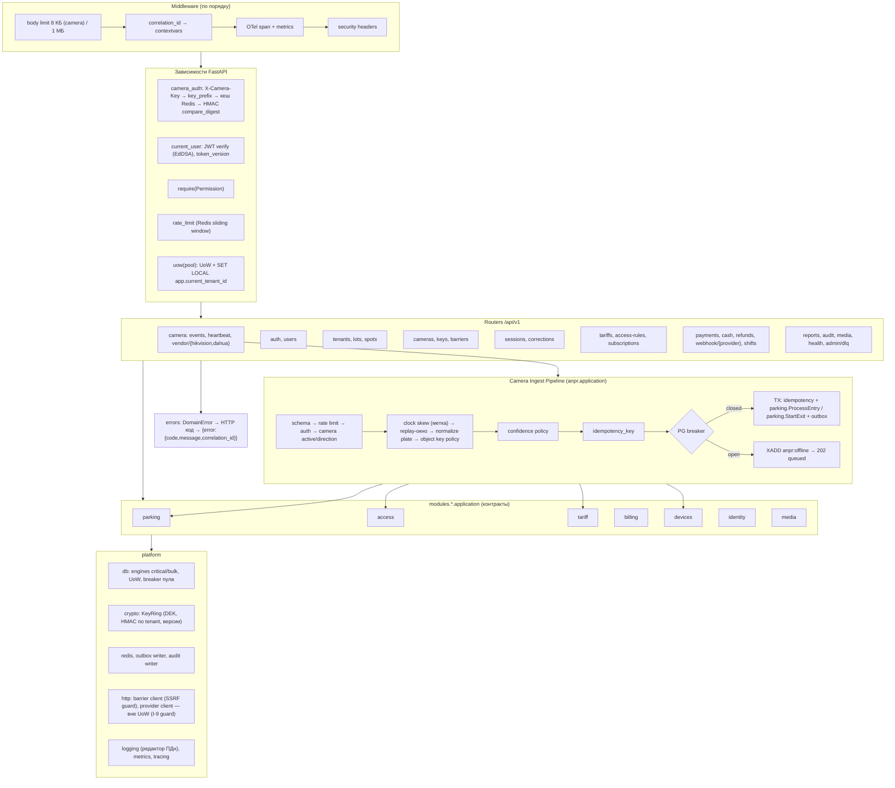

#### Stream Consumer

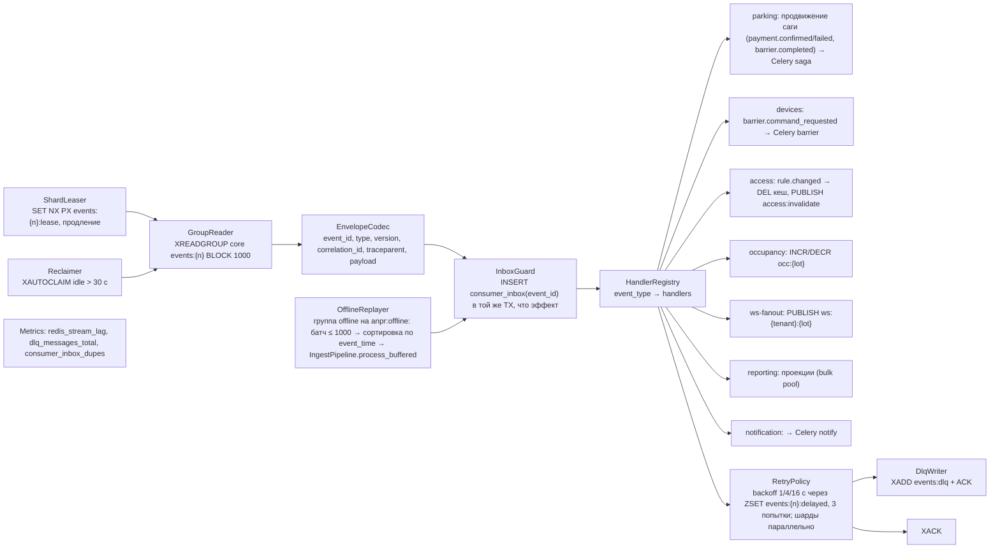

#### Outbox Publisher

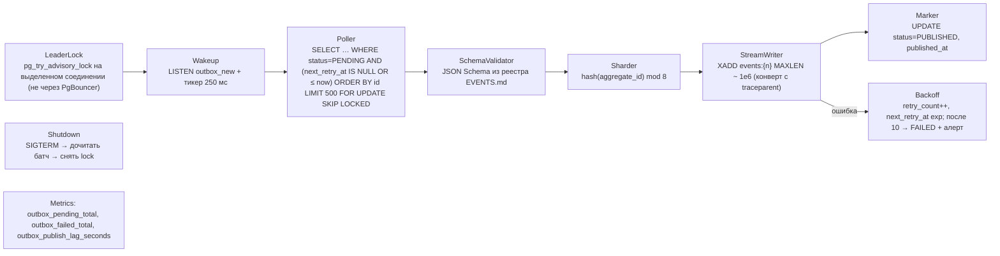

Порядок на агрегат: транзакции одного агрегата сериализованы блокировкой его строки (оптимистичная `version` + `SELECT … FOR UPDATE` в саге), поэтому их `outbox.id` монотонны; единственный активный publisher читает по `id`; шард по `aggregate_id` фиксирован; в шарде один активный потребитель. Разные агрегаты порядка не гарантируют — обработчики к этому устойчивы (проверяют состояние, не последовательность).

---

## 2. Bounded contexts

### 2.1 Проверка гипотезы

Исходный список из 15 контекстов недоступен — MASTER SPECIFICATION v2.0 в кит не входит (ASSUMPTIONS A-00). Кандидаты восстановлены из структуры модулей фазы 3 и ссылок на ТЗ. Критерий: контекст существует, если у него **свой язык и свои инварианты**.

| Кандидат | Свой язык? | Свои инварианты? | Вердикт |
|---|---|---|---|
| Tenant Management | нет — «tenant, площадка, вместимость» — это язык топологии | нет собственных, кроме уникальности кодов | **слит в Tenancy** вместе с Lot Management |
| Identity & Access | да — пользователь, роль, разрешение, семейство refresh | да — reuse refresh отзывает семейство, lockout | **отдельный** (`identity`); гипотеза о слиянии с Tenant Management отвергнута: инварианты токенов не имеют отношения к топологии |
| Parking Lot Management | да — площадка, место, вместимость, таймзона | capacity > 0, код уникален в tenant | **Tenancy** (`tenancy`) |
| Camera Management | да — камера, ключ, heartbeat, направление, здоровье | ключ уникален, `confidence_review_min ≤ confidence_min` | **Devices** (`devices`) |
| Barrier Control | да — команда, драйвер, стрела, breaker | `close` не ретраится, `reason` обязателен (I-15) | **Devices** — то же оборудование площадки, тот же жизненный цикл здоровья; собственных агрегатов достаточно для модуля, но не для контекста |
| ANPR Ingest | да — событие, confidence, replay-окно, конверт | I-3, I-4 | **отдельный** (`anpr`) |
| Parking Session | да — сессия, въезд, выезд, orphan, сага | I-1, I-16 | **отдельный** (`parking`) |
| Vehicle | нет — только идентичность | нет | **в Parking** (ADR-06) |
| Tariff | да — план, версия, правило, округление | I-7, I-12 | **отдельный** (`tariff`) |
| Access lists ×4 + Subscription | один общий язык — правило, область, срок, приоритет | I-8 | **один контекст Access Control** (ADR-03); абонемент — правило со сроком и ссылкой на платёж |
| Payment / Refund / Reconciliation | да — обязательство, попытка, возврат, расхождение, смена | I-6, сумма возвратов ≤ платежа | **один контекст Billing** (`billing`); сверка — процесс внутри него |
| Audit | да — действие, актор, reason | I-11, I-15 | **отдельный** (`audit`) |
| Media | да — объект, presigned, ретеншен | шаблон ключа объекта, TTL | **отдельный** (`media`) |
| Reporting / Analytics | один язык — период, агрегат, проекция; инвариантов нет | нет | **один контекст Reporting** (`reporting`) — оба читают одни факты |
| Notification | да — канал, получатель, дедупликация | нет доменных | **отдельный** (`notification`), чисто downstream |
| Privacy (ЗРУ-547 / GDPR) | да — запрос, верификация, ретеншен, анонимизация | финансовые данные не удаляются, необратимость | **добавлен** (`privacy`) — в структуре фазы 3 его нет, модуль появится к фазе 10, таблица запросов проектируется в фазе 2 |

**Итог: 13 контекстов.** Отклонения: слиты Tenant + Lot Management, Analytics + Reporting, Barrier Control → Devices, четыре списка + Subscription → Access Control, Vehicle → Parking, Reconciliation → Billing; добавлен Privacy.

### 2.2 Паспорта контекстов

Формат: назначение · агрегаты (корень в скобках) · граница транзакции · VO · domain events · integration events · зависимости · таблицы (имена черновика фазы 2 там, где они есть; остальные — описательно, имена выбирает фаза 2).

**Identity** (`modules/identity`)
- Назначение: кто и с какими правами работает в системе.
- Агрегаты: `User` (root) — учётные данные, роль, `token_version`, `lot_scope`; `RefreshTokenFamily` (root) — цепочка ротации.
- Транзакция: логин = проверка + запись попытки + выдача пары токенов атомарно; ротация refresh = пометка использованного + выпуск нового в одной TX; детекция reuse = отзыв всего семейства в одной TX.
- VO: `Email`, `PasswordHash` (argon2), `Role`, `Permission`, `TokenId`, `LotScope`.
- Domain events: `UserCreated`, `RoleChanged`, `PasswordChanged`, `RefreshReuseDetected`, `LoginLockedOut`.
- Integration: `identity.user.role_changed.v1`, `identity.refresh_reuse_detected.v1`, `identity.login_locked.v1`.
- Зависимости: потребляет — `tenancy` (контракт: tenant активен); публикует → Notification, Audit (контракт).
- Таблицы: пользователи, refresh-токены (семейства), попытки входа.

**Tenancy** (`modules/tenancy`)
- Назначение: организации и физическая топология площадок.
- Агрегаты: `Tenant` (root) — код, валюта, таймзона, `crypto_key_ref`/версия; `ParkingLot` (root) — вместимость, таймзона, политики (`unknown_exit_policy`, `deny_entry_when_full`, `max_session_hours`, аллоклист подсетей шлагбаумов) и `ParkingSpot` внутри.
- Транзакция: изменение площадки со всеми её местами; создание tenant вместе с созданием ключей в Vault (Vault — вне TX: сначала ключ, потом запись).
- VO: `TenantCode`, `LotCode`, `Capacity`, `TimeZone`, `CidrAllowlist`.
- Domain events: `TenantCreated`, `LotUpdated`, `LotDeactivated`.
- Integration: `tenancy.lot.updated.v1`, `tenancy.tenant.created.v1`.
- Зависимости: upstream для всех; потребляет ничего.
- Таблицы: `tenant`, `parking_lot`, места.

**Devices** (`modules/devices`)
- Назначение: камеры, их ключи и здоровье; шлагбаумы и команды им.
- Агрегаты: `Camera` (root) с `CameraApiKey`; `Barrier` (root) — endpoint, драйвер, `auth_secret_ref`, состояние; `BarrierCommand` (root) — идемпотентная команда с результатом.
- Транзакция: команда шлагбаума **записывается до отправки** (одна TX), результат — отдельной TX после HTTP (I-9); ротация ключа — новый ключ + срок старого в одной TX.
- VO: `CameraCode`, `Direction`, `ConfidencePolicy`, `ClockSkewPolicy`, `KeyPrefix`, `KeyHmac`, `BarrierEndpoint` (валидируется против SSRF-политики площадки), `DriverKind`, `CommandReason`.
- Domain events: `CameraStatusChanged`, `CameraKeyIssued/Revoked`, `BarrierCommandRequested/Completed/Failed`, `BarrierCircuitOpened`.
- Integration: `devices.camera.status_changed.v1`, `devices.camera_key.revoked.v1`, `devices.barrier.command_requested.v1`, `devices.barrier.command_completed.v1`.
- Зависимости: потребляет `tenancy` (площадка, аллоклист); публикует → Parking (сага ждёт `command_completed`), Notification, Reporting.
- Таблицы: `camera`, `camera_api_key`, `barrier`, `barrier_command`.

**ANPR Ingest** (`modules/anpr`)
- Назначение: превратить HTTP-запрос камеры в принятое, валидное, однократное событие.
- Агрегаты: `AnprEvent` (root) — принятое событие с меткой skew/duplicate/queued; `IdempotencyRecord` (root) — ключ → первый результат.
- Транзакция: идемпотентность + событие + вызов Parking (ENTRY или старт EXIT-саги) + outbox — **одна TX**; в оффлайне — конверт в Redis Stream **до** ответа (I-4).
- VO: `RawPlate`, `PlateNumber` (нормализованный, маскирующий `__repr__`), `Confidence`, `EventTime`, `ImageObjectKey`, `IdempotencyKey`, `Envelope`.
- Domain events: `EventAccepted`, `EventDuplicate`, `EventRejected(reason)`, `EventQueuedOffline`.
- Integration: `anpr.event.accepted.v1` (для Reporting и здоровья камер).
- Зависимости: потребляет контракты `devices` (аутентификация ключа, конфиг камеры), `parking` (команды), `media` (политика ключа объекта, put для vendor-адаптеров); публикует → Reporting, Devices (активность камеры).
- Таблицы: `anpr_event` (партиции по месяцам), `anpr_idempotency`.

**Parking** (`modules/parking`)
- Назначение: жизненный цикл сессии от въезда до закрытия; EXIT-сага; orphan; ручные коррекции.
- Агрегаты: `Vehicle` (root, ADR-06); `ParkingSession` (root) — статус, времена, `raw_plate`/`corrected_plate` (I-16), `version`; `ExitSaga` (root) — состояние, шаг, дедлайны, snapshot решения и расчёта; `ManualCorrection` (часть сессии).
- Транзакция: ENTRY — vehicle + сессия + outbox (одна TX, I-1 через уникальный индекс); каждый шаг саги — своя TX; закрытие сессии и завершение саги — одна TX.
- VO: `SessionStatus`, `BillingMinutes`, `SagaState`, `SagaStep`, `CorrectionReason`, `ExitKind` (`CAMERA`, `INFERRED_BY_PAYMENT`, `MANUAL`).
- Domain events: `SessionCreated`, `SessionClosed`, `SessionOrphaned`, `SessionMovedToManualReview`, `PlateCorrected`, `ExitSagaAdvanced`.
- Integration: `parking.session.created.v1`, `parking.session.closed.v1`, `parking.session.orphaned.v1`, `parking.session.manual_review.v1`, `parking.exit.requested.v1`, `parking.plate.corrected.v1`.
- Зависимости: потребляет контракты `access` (`resolve`), `tariff` (`calculate`, версия на момент), `billing` (`create_payment`, `settle_zero`), `devices` (`request_barrier_open`); потребляет события `billing.payment.confirmed/failed`, `devices.barrier.command_completed`. Публикует → Billing, Devices, Reporting, Notification, WS.
- Таблицы: `vehicle`, `parking_session` (HASH по `lot_id`, решение фазы 2), сага выезда, ручные коррекции.

**Tariff** (`modules/tariff`)
- Назначение: сколько стоит стоянка — детерминированно.
- Агрегаты: `TariffPlan` (root) с `TariffPlanVersion` (validity, rules), `HolidayCalendar` (root).
- Транзакция: публикация версии = одна TX, EXCLUDE защищает I-12.
- VO: `Money` (shared kernel), `TariffRules` (grace, first hour, hourly, daily max, overnight window, rounding, weekday overrides), `BreakdownLine`, `TariffCalculation`.
- Domain events: `VersionPublished`.
- Integration: `tariff.version.published.v1` (Reporting, инвалидация кеша версии).
- Зависимости: потребляет `access` только как входной `AccessDecision` (тип из `access.application.contracts`); pure-функция `calculate` без I/O.
- Таблицы: `tariff_plan`, `tariff_plan_version`, праздничный календарь.

**Access Control** (`modules/access`)
- Назначение: единое решение о праве проезда и льготе.
- Агрегаты: `AccessRule` (root) — вид, область, срок, скидка, источник; `Subscription` (root, сателлит правила) — период, ссылка на платёж, продление.
- Транзакция: запись правила + outbox `rule.changed` в одной TX; post-commit — инвалидация кеша (ADR-04).
- VO: `AccessKind` (`NORMAL`, `VIP`, `SUBSCRIPTION`, `WHITELIST`, `BLACKLIST`), `DiscountPercent`, `Validity`, `AccessDecision`.
- Domain events: `RuleAdded/Revoked`, `SubscriptionExpired`.
- Integration: `access.rule.changed.v1`, `access.subscription.expiring.v1`.
- Зависимости: upstream для Parking и Tariff; потребляет `billing.payment.confirmed` для активации абонемента.
- Таблицы: правила доступа (единая), абонементы.

**Billing** (`modules/billing`)
- Назначение: обязательства, их исполнение, возвраты, смены, сверка.
- Агрегаты: `Payment` (root) с `PaymentAttempt`; `Refund` (root, ссылка на Payment); `CashierShift` (root); `Reconciliation` (root) с `Discrepancy`; `WebhookInbox` (осиротевшие и дедуплицированные вебхуки).
- Транзакция: создание платежа с `calculation_snapshot` — одна TX; вызов провайдера — **вне TX**; применение вебхука — одна TX с inbox; возврат — проверка суммы в БД (CHECK/триггер) в той же TX.
- VO: `Money`, `PaymentMethod`, `PaymentStatus`, `IdempotencyKey`, `ProviderTxId`, `CalculationSnapshot`, `DiscrepancyKind`.
- Domain events: `PaymentCreated`, `PaymentConfirmed`, `PaymentFailed`, `PaymentCancelled`, `RefundCreated`, `DiscrepancyOpened`, `ShiftClosed`.
- Integration: `billing.payment.requested.v1`, `billing.payment.confirmed.v1`, `billing.payment.failed.v1`, `billing.payment.cancelled.v1`, `billing.refund.created.v1`, `billing.reconciliation.discrepancy_opened.v1`.
- Зависимости: ACL к провайдерам (`PaymentGateway` порт); потребляет `parking.session.closed` (закрытие по платежу — `EXIT_INFERRED` инициирует Parking по событию `payment.confirmed`, не наоборот); публикует → Parking (сага), Access (абонементы), Reporting, Notification.
- Таблицы: `payment`, попытки, возвраты, смены, сверка и расхождения, inbox вебхуков.

**Audit** (`modules/audit`)
- Назначение: неизменяемая летопись действий людей и системы.
- Агрегаты: `AuditEntry` (root, append-only), `EventLogEntry`.
- Транзакция: запись аудита — в TX действия через контракт `AuditWriter` (I-15); журнал событий — `bulk` пул.
- VO: `Action`, `Actor` (user / camera / system), `Reason`, `EntityRef`.
- Integration: не публикует; потребляет все integration events для `event_log`.
- Таблицы: `audit_log` (партиции по месяцам, `GRANT INSERT, SELECT` only — I-11), `event_log`.

**Media** (`modules/media`)
- Назначение: изображения без прохода через API.
- Агрегаты: `MediaObject` (root) — ключ по шаблону `tenant/{t}/lot/{l}/camera/{c}/YYYY/MM/DD/{uuid}.jpg`, статус доставки.
- Транзакция: выдача presigned URL — без TX; отметка `delivered` — `bulk`.
- VO: `ObjectKey` (валидация шаблона и принадлежности tenant/lot/camera), `PresignTtl`, `ContentType` (только `image/jpeg`).
- Integration: `media.object.undelivered.v1` (повтор).
- Зависимости: потребляет `tenancy`/`devices` для проверки принадлежности ключа.
- Таблицы: реестр объектов (минимальный: ключ, сессия/событие, статус).

**Reporting** (`modules/reporting`)
- Назначение: отчёты и аналитика по фактам других контекстов.
- Агрегаты: нет (read model). Проекции: дневная выручка по методам, средняя длительность, льготы, коррекции, расхождения, здоровье устройств.
- Транзакция: обновление проекции + inbox в одной TX, `bulk` пул; тяжёлые отчёты — с async standby.
- Зависимости: Conformist ко всем integration events; собственные SQL-представления над таблицами upstream объявляются в миграциях Reporting и помечаются как принятая зависимость от схемы.
- Таблицы: проекции отчётов, материализованные представления.

**Notification** (`modules/notification`)
- Назначение: доставить людям то, что требует внимания.
- Агрегаты: `Notification` (root) — канал, получатель, дедуп-ключ, статус доставки.
- Транзакция: запись + inbox; отправка в Telegram — Celery `notify`, вне TX.
- Integration: потребляет `parking.session.manual_review`, `devices.camera.status_changed`, `devices.barrier.command_failed`, `billing.reconciliation.discrepancy_opened`, `identity.refresh_reuse_detected`, алерты Alertmanager (webhook).
- Таблицы: уведомления, подписки получателей.

**Privacy** (`modules/privacy`)
- Назначение: запросы субъектов ПДн по ЗРУ-547/GDPR — от приёма до необратимой анонимизации.
- Агрегаты: `DeletionRequest` (root) — состояния `REQUESTED → IDENTITY_VERIFIED → LEGAL_RETENTION_CHECK → ANONYMIZATION → MEDIA_DELETION → AUDIT → COMPLETED`.
- Транзакция: каждый шаг — своя TX; анонимизация номера (замена `plate_hash`/`plate_encrypted` необратимым токеном) — через контракты Parking/Billing/Access; удаление медиа — через Media.
- Integration: `privacy.deletion.completed.v1`.
- Таблицы: запросы на удаление.

### 2.3 Context map

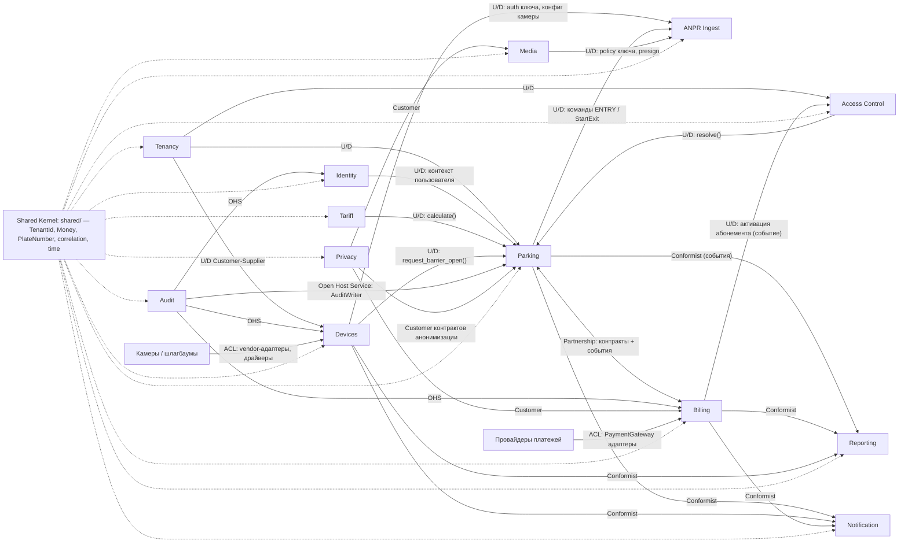

| Связь | Тип | Механизм | Что нельзя |
|---|---|---|---|
| Tenancy → Devices, Access, Parking | Customer/Supplier | `tenancy.application.contracts` (LotInfo, политики) | читать `parking_lot` из чужого репозитория |
| Devices → ANPR | Customer/Supplier | `CameraAuthenticator`, `CameraConfigReader` | ANPR не знает HMAC-хранилище |
| Parking → ANPR | Customer/Supplier | команды `ProcessEntry`, `StartExit` в одной UoW | ANPR не создаёт сессии сам |
| Access → Parking, Tariff | Customer/Supplier | `AccessResolver.resolve()`; `AccessDecision` — published language | Parking не читает списки |
| Tariff → Parking | Customer/Supplier | `TariffCalculator.calculate()`, `TariffVersionReader` | Parking не интерпретирует правила |
| Parking ↔ Billing | Partnership | Parking вызывает `create_payment/settle_zero`; Billing публикует `payment.*`; Parking реагирует событием | Billing не меняет статус сессии напрямую — только через событие `payment.confirmed`, на которое Parking отвечает `EXIT_INFERRED` |
| Devices → Parking | Customer/Supplier | `BarrierCommands.request_open(reason, idempotency_key)` + событие результата | сага не ходит к драйверу |
| Audit → все | Open Host Service | `AuditWriter.record()` в той же UoW | UPDATE/DELETE аудита |
| Media → ANPR, API | Customer/Supplier | `ObjectKeyPolicy.validate()`, `Presigner` | ключ объекта из тела без проверки принадлежности |
| Все → Reporting, Notification | Conformist | только integration events + inbox | доступ к чужим репозиториям; исключение — SQL-представления Reporting, объявленные в его миграциях |
| Privacy → Parking, Billing, Media, Access | Customer | контракты `anonymize(plate_hash)`, `delete_media(session)` | DELETE финансовых строк |
| Внешние системы | ACL | адаптеры за портами `PaymentGateway`, `BarrierDriver`, `VendorCameraAdapter` | vendor-формат за пределами адаптера |

---

## 3. Sequence diagrams

Обозначения: голубой блок — открытая транзакция PostgreSQL (`app_critical`, если не сказано иное). Внешние HTTP-вызовы всегда **вне** блоков — это визуальная проверка I-9.

### SD-1. ENTRY, happy path

```mermaid
sequenceDiagram
  autonumber
  participant CAM as Камера въезда
  participant ING as Camera Ingest
  participant RD as Redis
  participant PG as PostgreSQL
  participant OBX as Outbox Publisher
  participant CONS as Stream Consumer
  participant CEL as Celery barrier
  participant BAR as Контроллер шлагбаума

  CAM->>ING: POST /api/v1/camera/events (X-Camera-Key; ENTRY, plate, confidence, event_time, image_object_key)
  ING->>ING: body ≤ 8 КБ, схема Pydantic
  ING->>RD: rate limit по ключу камеры (sliding window)
  ING->>RD: GET camkey:{prefix} — запись ключа из кеша (TTL 60 с), промах → PG
  ING->>ING: HMAC-SHA256(pepper) + compare_digest; камера активна; direction = IN
  ING->>ING: clock skew → пометка + метрика; replay-окно; normalize(plate) → plate_hash; шаблон image_object_key; confidence policy; idempotency_key
  ING->>RD: GET access:{tenant}:{lot}:{plate_hash}
  alt промах кеша
    ING->>PG: отдельная read-only TX — одна выборка правил доступа
    ING->>RD: SET access:… TTL 300 с
  end
  rect rgb(232,240,254)
    Note over ING,PG: TX-1 BEGIN — SET LOCAL app.current_tenant_id; внешних вызовов нет (I-9)
    ING->>PG: INSERT anpr_idempotency(key) — конфликт → ветка SD-4
    ING->>PG: INSERT anpr_event(received_at, skew_flag)
    ING->>PG: INSERT vehicle ON CONFLICT (tenant_id, plate_hash) DO UPDATE last_seen_at RETURNING id
    ING->>PG: INSERT parking_session(ACTIVE, raw_plate) — partial unique I-1; конфликт → re-entry / duplicate (A-07)
    ING->>PG: INSERT barrier_command(PENDING, reason AUTO_ENTRY, idempotency_key) — только если decision ≠ BLACKLIST и confidence ≥ min
    ING->>PG: INSERT outbox(parking.session.created.v1), outbox(devices.barrier.command_requested.v1)
    Note over ING,PG: TX-1 COMMIT (remote_apply) → триггер NOTIFY outbox_new
  end
  ING-->>CAM: 200 {status ENTRY_CONFIRMED, session_id, barrier_command_id, correlation_id, duplicate false}
  Note over ING,CAM: ответ после коммита, не дожидаясь шлагбаума
  OBX->>PG: TX-2: SELECT outbox … FOR UPDATE SKIP LOCKED ORDER BY id
  OBX->>RD: XADD events:{hash(aggregate_id) mod 8} (конверт с traceparent, correlation_id)
  OBX->>PG: TX-2: UPDATE status = PUBLISHED; COMMIT
  CONS->>RD: XREADGROUP core events:{n}
  CONS->>CEL: apply_async(execute_barrier_command, command_id) → очередь barrier
  CONS->>RD: INCR occ:{lot}; PUBLISH ws:{tenant}:{lot} SESSION_CREATED, OCCUPANCY
  rect rgb(232,240,254)
    Note over CEL,PG: TX-3 BEGIN
    CEL->>PG: SELECT barrier_command FOR UPDATE — если не PENDING → выход (идемпотентно); UPDATE state = SENT
    Note over CEL,PG: TX-3 COMMIT
  end
  CEL->>BAR: open (timeout 3 с, retry 3, backoff 0.5/1/2 + jitter, circuit breaker) — вне транзакции
  BAR-->>CEL: OK
  rect rgb(232,240,254)
    Note over CEL,PG: TX-4 BEGIN
    CEL->>PG: UPDATE barrier_command(OK, latency); INSERT audit_log; INSERT outbox(devices.barrier.command_completed.v1)
    Note over CEL,PG: TX-4 COMMIT
  end
```

Ветки, не показанные: `confidence_review_min ≤ confidence < confidence_min` → сессия создаётся в `MANUAL_REVIEW`, `barrier_command` не пишется, ответ `MANUAL_REVIEW`, оператор подтверждает номер (SD-6-подобный ручной путь). `decision = BLACKLIST` → сессия в `MANUAL_REVIEW` с причиной `ENTRY_BLACKLIST` (машина у стрелы, место не занято — A-25), ответ `ENTRY_DENIED`, `barrier_command` не создаётся на уровне кода (I-8), уведомление оператору.

### SD-2. EXIT с оплатой (CASH — основной путь MVP, ONLINE — альтернатива)

```mermaid
sequenceDiagram
  autonumber
  participant CAM as Камера выезда
  participant ING as Camera Ingest
  participant PG as PostgreSQL
  participant EVT as Outbox → Stream → Consumer
  participant SAGA as Celery saga
  participant UI as Кассир / оператор (WS + REST)
  participant API as API
  participant PSP as Провайдер
  participant BAR as Шлагбаум

  CAM->>ING: POST /api/v1/camera/events (EXIT)
  ING->>ING: шаги 2–9 из SD-1 (валидация, auth, решение доступа из кеша → NORMAL)
  rect rgb(232,240,254)
    Note over ING,PG: TX-1 BEGIN
    ING->>PG: INSERT anpr_idempotency; INSERT anpr_event
    ING->>PG: SELECT parking_session ACTIVE by (lot_id, vehicle_id) — нет → политика unknown_exit (A-08)
    ING->>PG: SELECT версия тарифа, действующая в event_time (контракт tariff)
    ING->>ING: calculate(entry, exit, rules, decision, calendar, tz) → amount, breakdown — pure, без I/O
    ING->>PG: INSERT exit_saga(ACCESS_RESOLVED, snapshot, deadline +30 мин) — partial unique по session_id среди нетерминальных: второй EXIT присоединяется (A-09)
    ING->>PG: INSERT outbox(parking.exit.requested.v1)
    Note over ING,PG: TX-1 COMMIT
  end
  ING-->>CAM: 200 {status PAYMENT_REQUIRED, session_id, saga_id, amount}
  EVT->>SAGA: advance(saga_id)
  rect rgb(232,240,254)
    Note over SAGA,PG: TX-2 BEGIN — шаг PAYMENT_REQUIRED, идемпотентен по saga_id
    SAGA->>PG: SELECT exit_saga FOR UPDATE; проверка состояния
    SAGA->>PG: INSERT payment(PENDING, amount, calculation_snapshot, idempotency_key = saga_id) — контракт billing
    SAGA->>PG: UPDATE exit_saga(PAYMENT_REQUIRED, step_deadline +15 мин); INSERT outbox(billing.payment.requested.v1)
    Note over SAGA,PG: TX-2 COMMIT
  end
  EVT->>UI: WS PAYMENT {session, amount.formatted} — сумма только с бэкенда
  alt CASH
    UI->>API: POST /api/v1/payments/{id}/confirm-cash {shift_id} — permission payment:create_cash
    rect rgb(232,240,254)
      Note over API,PG: TX-3 BEGIN
      API->>PG: UPDATE payment PENDING→PAID, paid_at, operator_id (триггер I-6 разрешает переход); INSERT payment_attempt(CASH, shift_id)
      API->>PG: INSERT audit_log(operator_id, action CASH_PAYMENT); INSERT outbox(billing.payment.confirmed.v1)
      Note over API,PG: TX-3 COMMIT
    end
  else ONLINE (Payme / Click)
    rect rgb(232,240,254)
      SAGA->>PG: TX-3a: INSERT payment_attempt(PENDING, запрос без секретов); COMMIT
    end
    SAGA->>PSP: create(idempotency_key) — вне TX, timeout 5 с, breaker
    PSP-->>SAGA: intent {provider_tx_id, QR/redirect}
    rect rgb(232,240,254)
      SAGA->>PG: TX-3b: UPDATE payment_attempt(provider_tx_id, статус, латентность); COMMIT
    end
    Note over SAGA,PSP: таймаут → не повторять create; status(idempotency_key); неизвестно → saga PAYMENT_PENDING_VERIFICATION, машина не выпускается, оператор уведомлён
    PSP->>API: POST /api/v1/payments/webhook/{provider} (подпись)
    API->>API: подпись → окно времени (replay) — до любой записи
    rect rgb(232,240,254)
      API->>PG: TX-3c: INSERT webhook_inbox(provider_event_id, тело) ON CONFLICT DO NOTHING; COMMIT
    end
    API-->>PSP: 200 немедленно
    API->>SAGA: Celery payments: apply_webhook(inbox_id)
    rect rgb(232,240,254)
      SAGA->>PG: TX-3d: payment по provider_tx_id (нет → остаётся в inbox как orphan, повтор при появлении); сумма и валюта совпали; UPDATE PAID; attempt; INSERT outbox(billing.payment.confirmed.v1); COMMIT
    end
  end
  EVT->>SAGA: advance(saga_id) — по billing.payment.confirmed.v1
  rect rgb(232,240,254)
    Note over SAGA,PG: TX-4 BEGIN — шаг BARRIER_OPENING
    SAGA->>PG: UPDATE exit_saga(PAYMENT_SETTLED → BARRIER_OPENING); INSERT barrier_command(PENDING, reason AUTO_EXIT, idempotency_key = saga_id + step); INSERT audit_log
    Note over SAGA,PG: TX-4 COMMIT
  end
  SAGA->>BAR: open — вне TX, 3 попытки, breaker (контракт devices)
  BAR-->>SAGA: OK
  rect rgb(232,240,254)
    Note over SAGA,PG: TX-5 BEGIN — шаг SESSION_CLOSED
    SAGA->>PG: UPDATE barrier_command(OK); UPDATE parking_session(CLOSED, exit_time = event_time, billing_minutes, tariff_plan_version_id, exit_camera_id, version + 1)
    SAGA->>PG: UPDATE exit_saga(COMPLETED); INSERT outbox(parking.session.closed.v1), outbox(devices.barrier.command_completed.v1)
    Note over SAGA,PG: TX-5 COMMIT
  end
  EVT->>UI: WS SESSION_CLOSED, OCCUPANCY (DECR occ:{lot}); проекции отчётов; уведомления
```

Точки персистентности состояния саги: после TX-1 (`ACCESS_RESOLVED`), TX-2 (`PAYMENT_REQUIRED`), TX-3d/#3 (`PAYMENT_SETTLED` — ставится обработчиком события в TX-4), TX-4 (`BARRIER_OPENING`), TX-5 (`COMPLETED`). Падение процесса между любыми двумя — состояние в БД, шаг переигрывается идемпотентно (§4.4).

### SD-2b. Предоплата у оператора → EXIT (порядок MVP из CORE §11)

Кассир принимает оплату **до** появления машины у выездной камеры (будка на въезде/в зале, водитель платит и идёт к машине):

1. `POST /api/v1/sessions/{id}/payments {method CASH, shift_id}` — permission `payment:create_cash`. TX: `calculate(entry, now)` → `payment(PAID, amount, snapshot, paid_until = now + lot.exit_grace_minutes)` → `payment_attempt(CASH)` → `audit_log` → `outbox(billing.payment.confirmed.v1)`. Сумма считается на бэкенде и возвращается кассиру; кассир её не вводит.
2. EXIT-событие: в TX-1 (SD-2) рядом с активной сессией ищется `payment PAID` с `paid_until ≥ event_time` → сага создаётся сразу в `PAYMENT_SETTLED` с `amount 0`, ответ камере `EXIT_CONFIRMED`, далее шлагбаум как в SD-3.
3. `event_time > paid_until` → доплата: `calculate(paid_until, event_time)` → обычный путь SD-2 с новым платежом; исходный платёж не мутируется (I-6).
4. Оплатили, но выехали через полосу без камеры: джоб `maintenance` через `lot.exit_inferred_after_minutes` закрывает сессию как `EXIT_INFERRED`, `exit_time = paid_at` (A-11).

### SD-3. EXIT по абонементу — без оплаты

```mermaid
sequenceDiagram
  autonumber
  participant CAM as Камера выезда
  participant ING as Camera Ingest
  participant RD as Redis
  participant PG as PostgreSQL
  participant EVT as Outbox → Stream → Consumer
  participant SAGA as Celery saga
  participant BAR as Шлагбаум

  CAM->>ING: POST /api/v1/camera/events (EXIT)
  ING->>RD: GET access:… → SUBSCRIPTION (valid_until > event_time, source_id)
  rect rgb(232,240,254)
    Note over ING,PG: TX-1 BEGIN
    ING->>PG: INSERT anpr_idempotency; INSERT anpr_event; SELECT сессия ACTIVE; версия тарифа
    ING->>ING: calculate(…, decision SUBSCRIPTION) → amount 0, applied_rules [SUBSCRIPTION]
    ING->>PG: INSERT exit_saga(ACCESS_RESOLVED, amount 0); INSERT outbox(parking.exit.requested.v1)
    Note over ING,PG: TX-1 COMMIT
  end
  ING-->>CAM: 200 {status EXIT_CONFIRMED, session_id}
  EVT->>SAGA: advance(saga_id)
  rect rgb(232,240,254)
    Note over SAGA,PG: TX-2 BEGIN — amount 0: шаги платежа и шлагбаума схлопываются
    SAGA->>PG: settle_zero → INSERT payment(PAID, 0, method SUBSCRIPTION, source_id) — льгота видна в отчётах как использование, не как отсутствие платежа
    SAGA->>PG: UPDATE exit_saga(BARRIER_OPENING); INSERT barrier_command(PENDING, AUTO_EXIT); INSERT audit_log; INSERT outbox(billing.payment.confirmed.v1)
    Note over SAGA,PG: TX-2 COMMIT
  end
  SAGA->>BAR: open — вне TX
  BAR-->>SAGA: OK
  rect rgb(232,240,254)
    Note over SAGA,PG: TX-3 BEGIN
    SAGA->>PG: UPDATE barrier_command(OK); UPDATE parking_session(CLOSED); UPDATE exit_saga(COMPLETED); INSERT outbox(parking.session.closed.v1)
    Note over SAGA,PG: TX-3 COMMIT
  end
  Note over ING,BAR: Платёжный провайдер не участвует: его недоступность на этот путь не влияет (STOP-5 → решено)
```

Бюджет SLO «EXIT без оплаты p95 < 2 с»: TX-1 ≈ 15 мс, NOTIFY → XADD ≈ 10 мс, consumer → Celery ≈ 20 мс, TX-2 ≈ 10 мс, HTTP к шлагбауму 100–500 мс, TX-3 ≈ 10 мс → ≈ 0.3–0.8 с при исправном контроллере.

### SD-4. Дубликат ANPR-события

```mermaid
sequenceDiagram
  autonumber
  participant CAM as Камера
  participant ING as Camera Ingest
  participant RD as Redis
  participant PG as PostgreSQL

  CAM->>ING: POST /api/v1/camera/events — то же тело, тот же ключ (ретрай камеры)
  ING->>ING: валидация как в SD-1; idempotency_key = SHA256(tenant_id, camera_id, event_type, plate_hash, floor(event_time, 1 с))
  ING->>RD: GET idem:{key} — только ускорение, TTL 10 мин
  alt попадание в Redis
    ING-->>CAM: 200 сохранённый ответ, duplicate true
  else промах
    rect rgb(232,240,254)
      Note over ING,PG: TX-1 BEGIN
      ING->>PG: INSERT anpr_idempotency(key, …) ON CONFLICT DO NOTHING RETURNING key
      Note over ING,PG: при конкурентном первом запросе INSERT ждёт его коммита и видит конфликт: 100 параллельных → один победитель
      ING->>PG: SELECT result_kind, result_ref, response_snapshot WHERE idempotency_key = key
      Note over ING,PG: TX-1 ROLLBACK — ничего не изменено
    end
    ING->>RD: SET idem:{key} response_snapshot
    ING-->>CAM: 200 тот же session_id, тот же barrier_command_id, duplicate true — не 409
  end
  Note over ING,PG: сессия не создана, barrier_command не записан, шлагбаум не открыт повторно (I-3); лог INFO, метрика camera_event_duplicate_total
```

### SD-5. Оффлайн: PostgreSQL недоступен → Redis Stream → восстановление → консьюмер

```mermaid
sequenceDiagram
  autonumber
  participant CAM as Камера
  participant ING as Camera Ingest
  participant RD as Redis
  participant PG as PostgreSQL
  participant CONS as Stream Consumer (группа offline)

  ING->>PG: запросы падают → circuit breaker пула БД OPEN (5 отказов за 10 с)
  CAM->>ING: POST /api/v1/camera/events
  ING->>RD: auth: GET camkey:{prefix} (промах при мёртвом PG → 503, не 202)
  ING->>ING: валидация, plate_hash, idempotency_key — вычисляются ДО постановки в очередь
  ING->>RD: GET access:… (решение из кеша, промах → NORMAL с пометкой)
  ING->>RD: XADD anpr:offline MAXLEN ~ 1000000 {event_id, idempotency_key, correlation_id, received_at, retry_count 0, tenant_id, camera_id, body, decision, traceparent}
  alt XADD успешен
    ING-->>CAM: 202 {queued true, correlation_id} — не 200, камера различает
  else Redis отказал / MAXLEN близок
    ING-->>CAM: 503 — приём остановлен честно, не молча (I-4)
  end
  Note over ING,RD: шлагбаум в оффлайне: ENTRY и бесплатный EXIT открываются по кешу, команда в конверте; платный EXIT — ручной режим (A-10); метрика offline_mode_active = 1
  Note over PG: PostgreSQL восстановлен
  ING->>PG: breaker HALF-OPEN → проба → CLOSED; новые события снова в TX
  CONS->>RD: XREADGROUP offline anpr:offline COUNT 1000
  CONS->>CONS: сортировка батча по event_time (не по порядку stream)
  loop каждый конверт
    rect rgb(232,240,254)
      Note over CONS,PG: TX BEGIN — тот же ingest use case, что и онлайн
      CONS->>PG: INSERT anpr_idempotency (конфликт → уже обработано, пропуск); INSERT anpr_event(received_at из конверта); ProcessEntry / StartExit с event_time конверта; outbox; consumer_inbox(event_id)
      Note over CONS,PG: TX COMMIT
    end
    CONS->>RD: XACK
  end
  alt ошибка обработки 3 раза (backoff 1/4/16 с: запись ждёт в ZSET events:{n}:delayed, шард не блокируется)
    CONS->>RD: XADD anpr:dlq + XACK; dlq_messages_total; алерт; replay через админ-API с dry-run
  end
  Note over CONS,RD: XAUTOCLAIM idle > 30 с подбирает pending упавшего потребителя; EXIT раньше ENTRY между батчами → сессия задним числом (A-10)
```

### SD-6. Отказ шлагбаума после успешного платежа → ручной сценарий

```mermaid
sequenceDiagram
  autonumber
  participant SAGA as Celery saga
  participant PG as PostgreSQL
  participant BAR as Шлагбаум
  participant EVT as Outbox → Stream → Consumer
  participant NOT as Notification (Telegram, WS ALERT)
  participant OP as Оператор
  participant API as API

  Note over SAGA,PG: состояние PAYMENT_SETTLED — деньги получены (TX-3 из SD-2)
  rect rgb(232,240,254)
    SAGA->>PG: TX-4: exit_saga → BARRIER_OPENING; INSERT barrier_command(PENDING, AUTO_EXIT); audit; COMMIT
  end
  SAGA->>BAR: open — попытка 1 → timeout 3 с
  SAGA->>BAR: попытка 2 (0.5 с + jitter) → timeout
  SAGA->>BAR: попытка 3 (1 с + jitter) → 500
  Note over SAGA,BAR: breaker считает отказы: 5 подряд → OPEN 60 с → half-open 1 проба
  rect rgb(232,240,254)
    Note over SAGA,PG: TX-5 BEGIN — компенсации нет: платёж не трогаем (I-6), стрелу не откатить
    SAGA->>PG: UPDATE barrier_command(FAILED, ошибка); UPDATE exit_saga(MANUAL_REVIEW, reason BARRIER_FAILED); UPDATE parking_session(MANUAL_REVIEW)
    SAGA->>PG: INSERT outbox(parking.session.manual_review.v1), outbox(devices.barrier.command_completed.v1 {result FAILED})
    Note over SAGA,PG: TX-5 COMMIT
  end
  EVT->>NOT: Telegram дежурному + WS ALERT оператору площадки; метрика barrier_command_total{result=failed}
  OP->>API: POST /api/v1/barriers/{id}/open {reason} — permission barrier:open; без reason → 422 (I-15)
  rect rgb(232,240,254)
    Note over API,PG: TX-6 BEGIN
    API->>PG: INSERT barrier_command(PENDING, MANUAL, issued_by, reason); INSERT audit_log(user_id, reason); COMMIT
  end
  API->>BAR: open — вне TX (Celery barrier), breaker может быть OPEN → немедленный отказ с кодом
  alt контроллер ожил
    BAR-->>API: OK
    rect rgb(232,240,254)
      API->>PG: TX-7: command OK; exit_saga(SESSION_CLOSED → COMPLETED, barrier_result MANUAL); parking_session(CLOSED); outbox(session.closed); COMMIT
    end
  else контроллер мёртв — стрелу подняли ключом
    OP->>API: POST /api/v1/sessions/{id}/close {reason "opened by hand"} — permission sessions:close_manual
    rect rgb(232,240,254)
      API->>PG: TX-7': parking_session(CLOSED, exit_kind MANUAL); exit_saga(COMPLETED, barrier_result BYPASSED); audit; outbox; COMMIT
    end
  end
  Note over SAGA,API: Возврат денег — не автоматически: обязательство исполнено, проблема механическая. Возврат — отдельное действие с reason и permission payment:refund (фаза 5)
```

### SD-7. Ротация ключа камеры без простоя

```mermaid
sequenceDiagram
  autonumber
  participant ADM as Администратор tenant
  participant API as API
  participant PG as PostgreSQL
  participant EVT as Outbox → Consumer
  participant RD as Redis
  participant TECH as Техник на площадке
  participant CAM as Камера
  participant ING as Camera Ingest

  ADM->>API: POST /api/v1/cameras/{id}/keys {grace_hours 24} — permission cameras:rotate_key
  API->>API: сгенерировать 256-битный ключ; key_prefix = первые 16 символов; key_hmac = HMAC-SHA256(pepper, key)
  rect rgb(232,240,254)
    Note over API,PG: TX-1 BEGIN
    API->>PG: INSERT camera_api_key(new, active, key_prefix, key_hmac); UPDATE старый ключ SET expires_at = now + 24 ч (остаётся active)
    API->>PG: INSERT audit_log(rotate_key); INSERT outbox(devices.camera_key.issued.v1)
    Note over API,PG: TX-1 COMMIT
  end
  API-->>ADM: 201 {key — показан ОДИН раз, в БД только HMAC}
  EVT->>RD: DEL camkey:{old_prefix} (кеш перечитает запись со сроком)
  TECH->>CAM: прописать новый ключ в конфигурации камеры
  par оба ключа валидны в окне перекрытия
    CAM->>ING: события со старым ключом → 200 (до expires_at)
    CAM->>ING: события с новым ключом → 200
  end
  ING->>RD: HSET camkey:lastused {key_id} ts — батч-флаш в PG раз в 60 с (Celery maintenance, bulk пул)
  ADM->>API: GET /api/v1/cameras/{id}/keys → last_used_at показывает, что новый ключ в работе
  alt срок вышел или админ отозвал явно
    ADM->>API: DELETE /api/v1/cameras/{id}/keys/{old_id} {reason}
    rect rgb(232,240,254)
      API->>PG: TX-2: UPDATE old SET active = false, revoked_at, revoked_by; audit; outbox(devices.camera_key.revoked.v1); COMMIT
    end
    EVT->>RD: DEL camkey:{old_prefix}
    CAM->>ING: событие со старым ключом → 401 (единый ответ, постоянное время), метрика camera_auth_failed_total
  end
  Note over ADM,ING: Алерт warning, если старый ключ всё ещё используется за 4 ч до expires_at — техник не дошёл до камеры
```

---

## 4. State machines

Общее правило: каждый переход — одна транзакция, эффекты перехода (outbox, аудит) — в ней же. Поэтому «падение процесса в состоянии X» всегда означает: состояние X в БД, эффекты перехода либо целиком есть, либо целиком нет.

### 4.1 ParkingSession

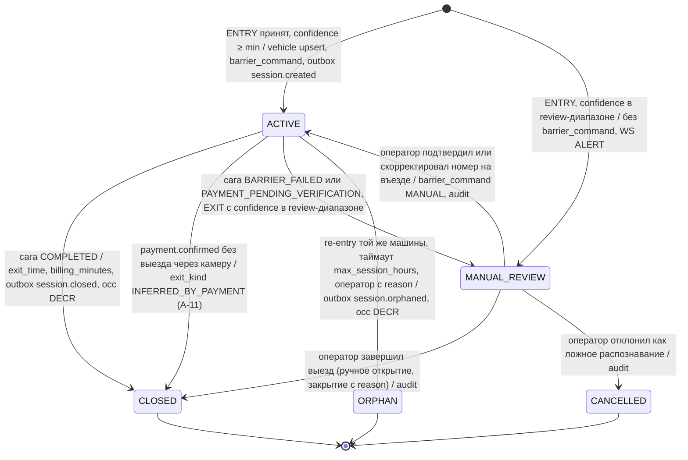

| Состояние | Таймаут | При падении процесса | Терминальное |
|---|---|---|---|
| `ACTIVE` | `lot.max_session_hours` (по умолчанию 72 ч, A-07) → кандидат в `ORPHAN` джобом `maintenance` | сессия в БД; шлагбаум открывается по outbox-событию, не по памяти процесса | нет |
| `MANUAL_REVIEW` | 15 мин без действия → эскалация (повторный алерт), автоперехода нет | очередь в БД, видна оператору после рестарта | нет |
| `CLOSED` / `ORPHAN` / `CANCELLED` | — | — | да |

`raw_plate` и `corrected_plate` — разные колонки (I-16); коррекция создаёт запись `manual_correction` с `reason` и `user_id` (I-15) и меняет `vehicle_id` сессии, старый `vehicle` не удаляется.

### 4.2 Payment

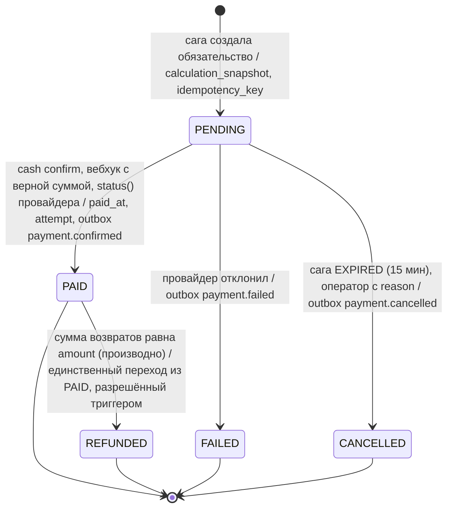

| Состояние | Таймаут | При падении процесса | Терминальное |
|---|---|---|---|
| `PENDING` | 15 мин (шаг саги) → `CANCELLED` | `PaymentAttempt` хранит, что было отправлено провайдеру; при рестарте — `status()`, не `create()` | нет |
| `PAID` | — | — | да (I-6): частичный возврат не меняет статус, `refunded_amount` производный |
| `REFUNDED` / `FAILED` / `CANCELLED` | — | — | да |

Поздний вебхук на `CANCELLED` (клиент заплатил после истечения) — не мутация: создаётся `ReconciliationDiscrepancy(STATUS_MISMATCH)`, решение оператора (возврат или зачёт).

### 4.3 Barrier

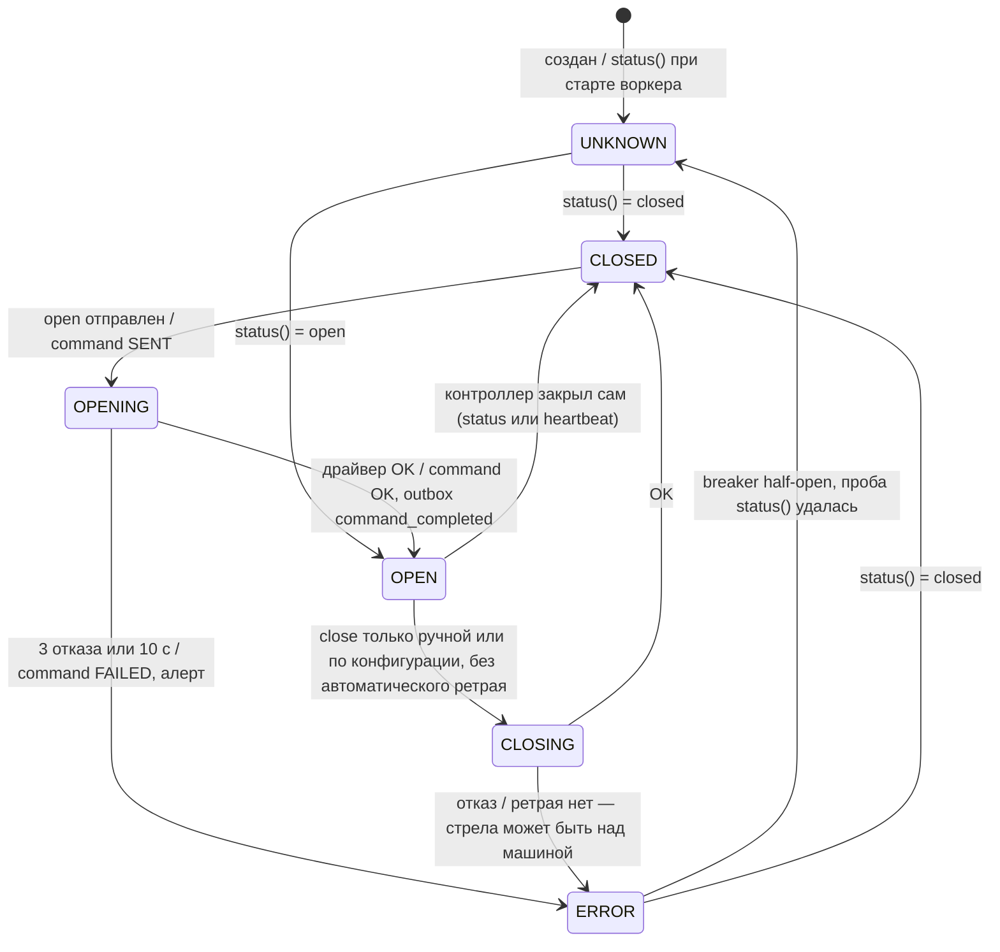

| Состояние | Таймаут | При падении процесса | Терминальное |
|---|---|---|---|
| `OPENING` | 3 с × 3 попытки + backoff ≈ 10 с → `ERROR` | `barrier_command` со `SENT` старше 30 с подбирается реклеймером: `status()` → если открыт — OK, иначе повтор `open` (идемпотентен) | нет |
| `CLOSING` | 3 с → `ERROR` | не повторяется автоматически; оператору — уведомление | нет |
| `ERROR` | breaker 60 с → half-open | состояние в БД, проба по расписанию | нет |
| остальные | опрос `status()` раз в 60 с при наличии драйвера | восстанавливается опросом | нет — терминальных нет, это кеш физического устройства |

### 4.4 ExitSaga

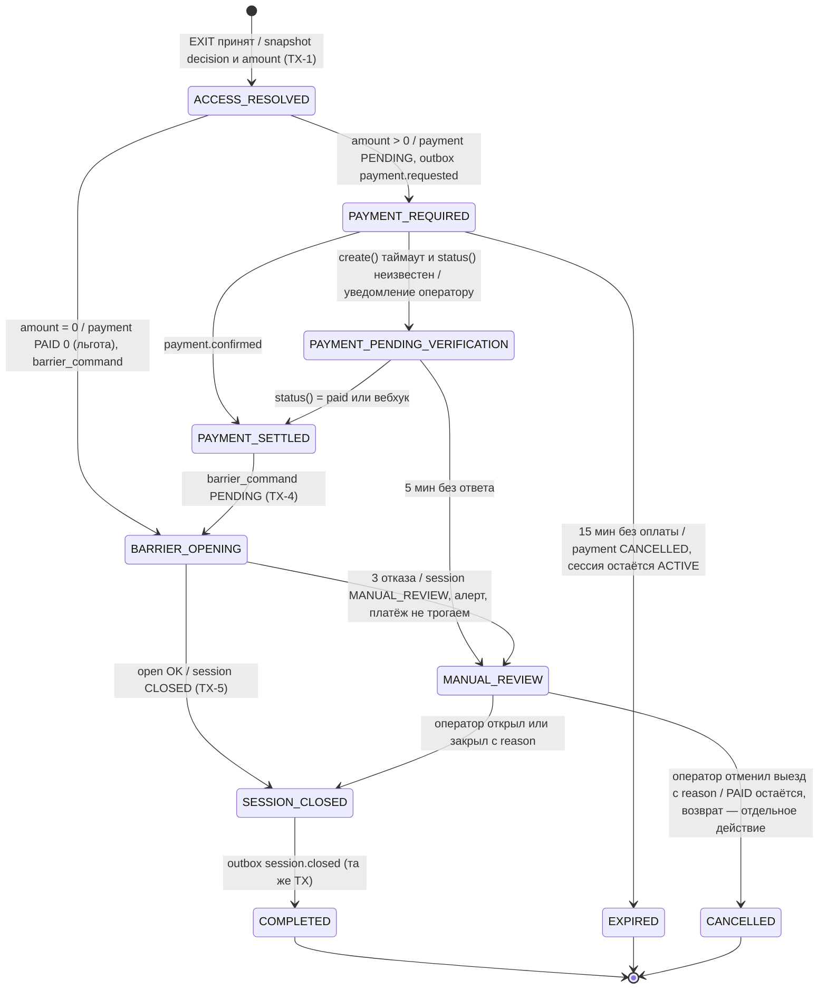

Компенсации по шагам:

| Шаг | Побочный эффект | Компенсация | Если компенсация невозможна |
|---|---|---|---|
| `ACCESS_RESOLVED` | только запись саги | не нужна | — |
| `PAYMENT_REQUIRED` | `payment PENDING`, у провайдера — intent | `PENDING → CANCELLED`; у провайдера intent истекает сам | — |
| `PAYMENT_PENDING_VERIFICATION` | возможно, списание, о котором мы не знаем | `status()` по нашему ключу, затем сверка | `MANUAL_REVIEW`: оператор видит платёж «неизвестен», машина не выпускается |
| `PAYMENT_SETTLED` | деньги получены | **нет** — обязательство исполнено (I-6) | все дальнейшие отказы → `MANUAL_REVIEW`, возврат только человеком |
| `BARRIER_OPENING` | команда контроллеру | `open` идемпотентен, повтор безопасен; стрелу «откатить» нельзя | `MANUAL_REVIEW` + алерт, ручное открытие с `reason` |
| `SESSION_CLOSED` | сессия закрыта, outbox | в той же TX — либо всё, либо ничего | — |

Таймауты: вся сага 30 мин (`EXPIRED`, если не дошла до `PAYMENT_SETTLED`); шаги — `ACCESS_RESOLVED` 5 с, `PAYMENT_REQUIRED` 15 мин, `PAYMENT_PENDING_VERIFICATION` 5 мин, `BARRIER_OPENING` 30 с, `SESSION_CLOSED` 5 с. Воркер `saga` при старте и раз в 30 с выбирает саги в нетерминальных состояниях с `step_deadline < now` (`FOR UPDATE SKIP LOCKED`) и переигрывает текущий шаг; каждый шаг проверяет состояние перед действием и использует `idempotency_key = saga_id + step` для платежа и команды шлагбаума — поэтому `kill -9` в любом состоянии даёт ровно один эффект (тест gate 3.5).

Второй EXIT по той же сессии (другая камера выезда) — присоединяется к нетерминальной саге (partial unique по `session_id`), фиксируется как `additional_event_id`, ответ камере — текущее состояние саги (A-09).

### 4.5 CameraHealth

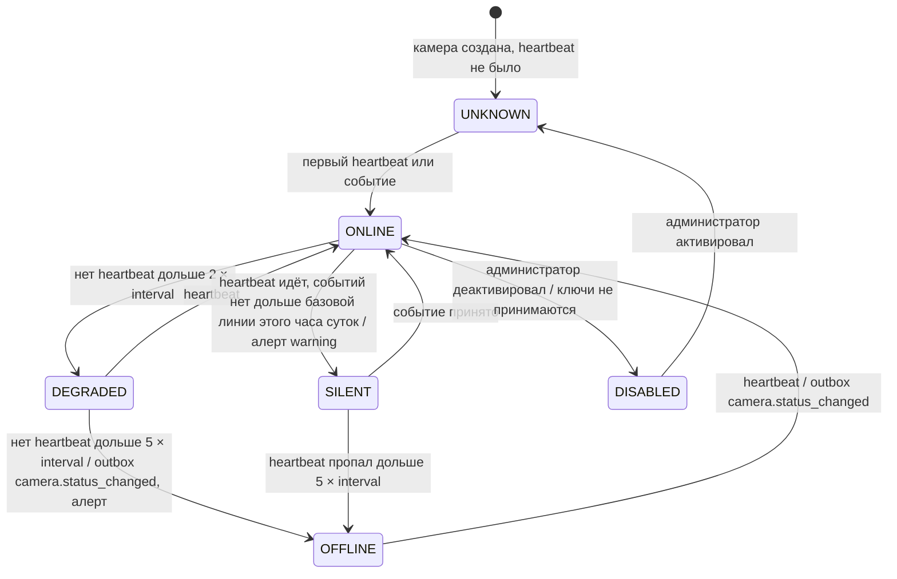

Состояние вычисляется джобом `maintenance` раз в 30 с из Redis (`HGET camera:hb:{id}`, последнее событие) — не на каждом heartbeat; переходы пишутся батчем в PG (`bulk`), только изменившиеся публикуются. `SILENT` — «жива, но не распознаёт»: базовая линия — медиана событий за тот же час за последние 14 дней, порог — 0 событий за 3 × ожидаемый интервал (минимум 30 мин). При падении процесса ничего не теряется — состояние производно от временных меток и пересчитывается. Терминальных состояний нет.

---

## 5. Failure matrix

| Отказавший компонент | Что деградирует | Что продолжает работать | Как обнаруживается | Автоматическое восстановление | Ручное действие |
|---|---|---|---|---|---|
| PostgreSQL primary | все записи; API-запросы к БД → circuit breaker | приём camera-событий (202 → Redis Stream), кеш доступа, WS-поток (устаревающий), чтение отчётов с async standby | `pg_up == 0`, рост 5xx/202, `offline_mode_active`, Patroni | Patroni промотирует sync standby (RTO ≤ 60 с цель, замер в фазе 9); PgBouncer переключает; breaker закрывается; consumer доливает буфер | если failover не случился за 2 мин — runbook 1: ручной `patronictl failover` |
| PostgreSQL sync standby | коммиты на primary **ждут** подтверждения → латентность растёт до таймаута | чтение | `pg_replication_lag`, рост p95 коммитов, алерт `sync_standby_missing` | Patroni `synchronous_mode` без `strict`: переводит primary в async (RPO временно > 0), алерт critical | восстановить standby, вернуть sync; runbook 2 |
| PostgreSQL async standby | отчёты и PITR-цепочка WAL на нём | всё критичное | лаг репликации, `pg_stat_replication` | Patroni переинициализирует реплику | проверить место на диске, `patronictl reinit` |
| PgBouncer (оба) | приложение теряет БД → как отказ primary с точки зрения приложения | как выше | `pgbouncer_up`, 202/503 | 2 реплики за Service; рестарт пода | — |
| Redis (весь кластер) | кеши мимо (p95 растёт), оффлайн-буфер недоступен, Celery стоит, rate limit выключен (fail-open с логом), WS без событий, heartbeat не пишется | приём событий при живом PG (полный путь в TX), outbox копится в PG | `redis_up == 0`, лаг очередей, `celery_workers_alive` | Sentinel failover; publisher/consumers переподключаются; occupancy пересчитывается сверкой ≤ 60 с | если PG тоже мёртв — API отвечает 503 честно; runbook 3 |
| MinIO | изображения не сохраняются/не открываются | всё остальное: событие принимается, `image_delivered = false`, повтор из очереди `maintenance` | `minio_up`, `media_undelivered_total` | повтор с backoff; presigned выдаются после восстановления | runbook, проверка EC-квоты |
| Vault | новые поды не стартуют (I-14), ротация ключей и создание tenant невозможны | все работающие поды — ключи в памяти | `vault_sealed`, `vault_up`, поды в `CrashLoopBackOff` | HA raft; auto-unseal | unseal; не масштабировать приложение, пока Vault недоступен |
| Celery workers (очередь) | `saga` — выезды зависают после ответа камере; `barrier` — стрелы не открываются на ENTRY; `payments` — вебхуки не применяются; `notify` — тихо | приём событий, UI | глубина очереди, `celery_task_age_seconds`, saga step timeouts | k8s перезапуск; саги переигрываются по дедлайну; задачи идемпотентны | ручной режим на площадке при > 2 мин |
| Outbox Publisher | все integration events задерживаются: саги не продвигаются, WS/occupancy устаревают, кеш доступа не инвалидируется (ADR-04: post-commit hook продолжает работать) | приём и запись в PG, ответы камерам | `outbox_publish_lag_seconds > 5`, `outbox_pending_total` | standby-реплика берёт advisory lock | — |
| Stream Consumer | события копятся в стримах, саги не продвигаются | приём, publisher | `redis_stream_lag`, pending растёт | ≥ 2 реплики; `XAUTOCLAIM` перехватывает pending | — |
| WebSocket Gateway | оператор без live | всё остальное | `ws_connections`, ошибки клиентов | реконнект клиента с бэкоффом и перезапросом состояния | — |
| Платёжный провайдер | CARD/ONLINE не проходят: `create()` → breaker OPEN | CASH, SUBSCRIPTION, VIP, whitelist — не зависят; сага ждёт до 15 мин | `payment_total{status=failed}`, breaker state, p95 подтверждения | breaker half-open; неизвестные платежи → `status()` | кассир принимает наличные; сверка после восстановления |
| Контроллер шлагбаума (один) | автоматический проезд на этой полосе | приём событий, сессии, платежи; остальные шлагбаумы | `barrier_command_total{result=failed}`, breaker, heartbeat шлагбаума | ретраи, breaker, `status()` проба | охранник открывает ключом; `sessions/{id}/close` с reason |
| Камера (одна) | события с этой полосы; на въезде — сессии не создаются, на выезде — orphan | остальные камеры | `CameraHealth` → OFFLINE/SILENT, алерт | — | ручной режим полосы; коррекции оператором |
| Сеть API ↔ БД (разрыв 30 с) | как отказ primary для приложения; открытые транзакции — `statement_timeout`/`idle_in_transaction_session_timeout` их убивают | 202 + буфер | breaker, `pg_up` с точки зрения приложения, TCP keepalive | breaker закрывается после проб; consumer доливает | — |
| Полная потеря зоны | ⅓ подов; при потере зоны primary — failover; при потере зоны Redis-мастера — Sentinel failover | подAntiAffinity гарантирует реплики в других зонах | node NotReady, Patroni, Sentinel | k8s пересоздаёт поды; Patroni/Sentinel failover | проверить кворумы (Patroni DCS, Sentinel, Vault raft — все по 3 в трёх зонах) |

---

## 6. Модель безопасности (каркас; полная threat-модель — фаза 10)

### 6.1 Границы доверия

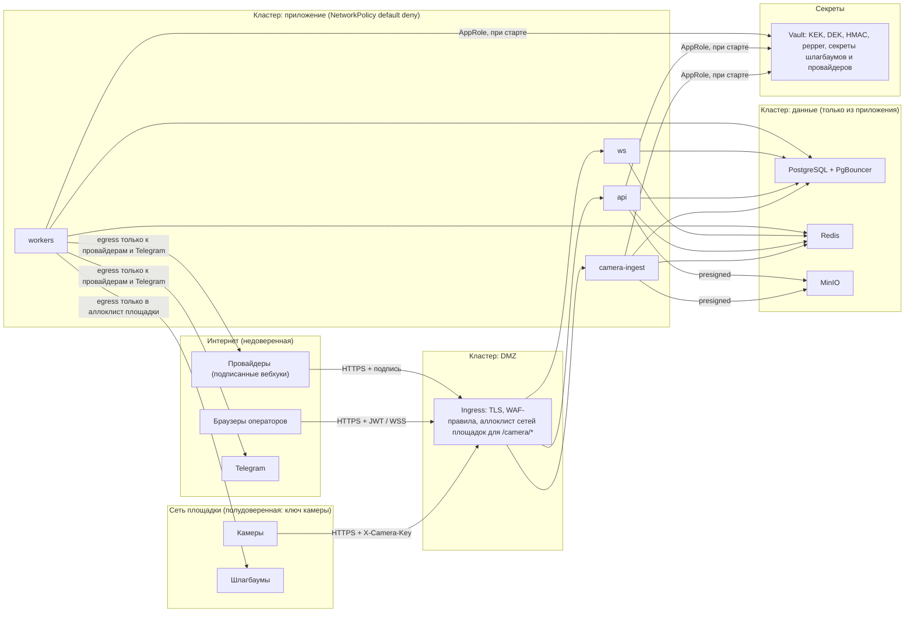

### 6.2 Три группы API

| Группа | Кто | Чем аутентифицируется | Что может | Что не может |
|---|---|---|---|---|
| **camera** `/api/v1/camera/*` | камеры и vendor-шлюзы | `X-Camera-Key` (256 бит, HMAC-SHA256 с pepper, `compare_digest`), ingress-аллоклист сетей площадок, rate limit по ключу | прислать событие и heartbeat **только за свою камеру**: tenant, lot, camera определяются ключом | ничего из тела не расширяет права; чужой `image_object_key` → 422; ключ не даёт чтения |
| **public** `/api/v1/auth/*`, `/api/v1/payments/webhook/*`, `/health/*` | анонимные клиенты, провайдеры | логин — пароль с anti-bruteforce и неразличимым ответом; вебхук — подпись провайдера + окно времени; health — без данных | получить пару токенов; доставить подписанное подтверждение | никаких данных tenant без токена; вебхук без подписи не читается дальше заголовка |
| **admin/operator** `/api/v1/*` (остальное), `/ws/v1/*` | операторы, кассиры, админы tenant, оператор платформы | JWT EdDSA, access 15 мин в памяти клиента, refresh 7 дней httpOnly cookie с ротацией и детекцией reuse; RBAC `require(Permission)`; скоуп площадки в репозитории; RLS вторым рубежом | только ресурсы своего tenant (чужие → 404); ручные действия только с `reason` | сменить `tenant_id`/`role` через тело или токен; увидеть чужой tenant даже при баге фильтра (RLS) |

Оператор платформы — отдельный tenant-нейтральный принципал с явной ролью; его действия над tenant'ами тоже аудируются.

### 6.3 Ключи

```
Vault Transit  KEK (platform, per-tenant key ring tenant-{id})
     │  wrap/unwrap при старте, ротации, создании tenant
     ▼
DEK_t (AES-256-GCM, версия v)   HMACK_t (HMAC-SHA256, версия v)   pepper (для ключей камер, глобальный, версия)
     │                                 │
     ▼                                 ▼
plate_encrypted = nonce || ct || tag   plate_hash = HMAC(HMACK_t, normalize(plate))
key_version в строке                   поиск по обеим версиям в переходный период
```

- В БД — только `crypto_key_ref` (путь в Vault) и `key_version`. Обёрнутые DEK/HMAC-ключи лежат в Vault KV под этим путём, не в БД: дамп БД не содержит ключевого материала.
- Процесс получает ключи при старте через AppRole (короткоживущий токен), держит в памяти `KeyRing{tenant → (DEK, HMACK, version)}`, обновляет по событию ротации. Vault на горячем пути отсутствует (Q9).
- **Компрометация ключа одного tenant:** blast radius — номера этого tenant за окно ретеншена. Действия: новая версия ключей в Transit → фоновая перешифровка `vehicle` и пересчёт `plate_hash` (двойной поиск на время перехода) → отзыв старой версии → аудит, какие процессы держали ключ (по логам старта). Другие tenant'ы не затронуты — ключи не разделяются.
- **Компрометация ключа камеры:** отзыв одного ключа (SD-7), остальные камеры не затронуты; события с отозванным ключом → 401 + метрика.
- **Секреты шлагбаумов и провайдеров** — только ссылки в БД (`auth_secret_ref`), значения в Vault, в памяти воркеров `barrier`/`payments`.

---

## 7. Инварианты → контекст → механизм → тест

| # | Инвариант | Контекст-владелец | Механизм принуждения | Где тест |
|---|---|---|---|---|
| I-1 | одна ACTIVE-сессия на (lot, vehicle) | Parking | partial unique index на партиционированной таблице (ключ партиции `lot_id` входит), `UniqueViolation` → идемпотентный ответ | `tests/invariants/test_i01_one_active_session.py` — 50 параллельных ENTRY |
| I-2 | нет чтения/записи чужого tenant | Tenancy (схема) + все контексты | RLS на все tenant-owned таблицы, роли без BYPASSRLS, `SET LOCAL` в UoW, обязательный фильтр в репозиториях | `tests/invariants/test_i02_tenant_isolation.py` — через репозиторий и через прямой SQL под ролью приложения, для каждой таблицы |
| I-3 | повторная доставка события — одна сессия, одно открытие | ANPR Ingest | PK `anpr_idempotency`, снимок ответа, ключ считается до постановки в очередь | `tests/invariants/test_i03_idempotency.py` — 100 параллельных идентичных, replay через 10 мин |
| I-4 | событие с 2xx не исчезает | ANPR Ingest | TX в PG либо `XADD` до ответа; ошибка `XADD` → 503; DLQ | `tests/invariants/test_i04_no_event_loss.py` — `docker stop` PG, сверка «отправлено == БД + DLQ» |
| I-5 | integration event не раньше коммита | platform (UoW/outbox) + все | публикация только из `outbox`, `collect_events()` пишет в той же TX | `tests/invariants/test_i05_outbox_after_commit.py` — откат TX → потребитель ничего не получил |
| I-6 | PAID/REFUNDED не мутируется | Billing | триггер BEFORE UPDATE на `payment`, компенсирующие записи `refund` | `tests/invariants/test_i06_payment_immutable.py` — UPDATE под ролью приложения отклонён |
| I-7 | расчёт детерминирован | Tariff | `calculate()` — pure, без I/O; snapshot в платеже | `tests/invariants/test_i07_tariff_deterministic.py` — hypothesis: детерминизм, неотрицательность, монотонность |
| I-8 | blacklist → нет автоматического открытия | Access Control (решение) + Parking (ветка) | `AccessDecision.kind == BLACKLIST` → `barrier_command` не создаётся на уровне кода; приоритет в одной функции | `tests/invariants/test_i08_blacklist_no_auto_open.py` |
| I-9 | открытая TX не ждёт внешний HTTP | platform | contextvar «UoW активен»; транспорт httpx бросает `TransactionBoundaryViolation`; AST-тест на импорты http-клиентов в domain/application | `tests/invariants/test_i09_no_http_in_uow.py` + `tests/architecture/` |
| I-10 | номер нигде в открытом виде | Parking (хранение), platform (логи/метрики/трейсы/Sentry) | нет plaintext-колонки; `PlateNumber.__repr__` маскирует; structlog-редактор; `before_send` Sentry; запрет label в метриках | `tests/invariants/test_i10_no_plaintext_plate.py` — grep схемы, выхлоп логгера, `before_send` |
| I-11 | audit_log append-only | Audit | `GRANT INSERT, SELECT` только; без UPDATE/DELETE/TRUNCATE у ролей приложения | `tests/invariants/test_i11_audit_append_only.py` — DELETE/UPDATE под ролью отклонены |
| I-12 | версии тарифа не пересекаются | Tariff | `EXCLUDE USING gist (plan_id WITH =, validity WITH &&)`, таблица не партиционируется | `tests/invariants/test_i12_tariff_no_overlap.py` |
| I-13 | деньги — целые минорные единицы | shared kernel (`Money`) + все | `Money` без `__float__`/`__int__`, `BIGINT` в БД, запрет `float` в Pydantic-схемах, ruff-правило | `tests/invariants/test_i13_money_integer.py` — property-based на сложение/деление |
| I-14 | старт без секрета невозможен | platform (config) | pydantic-settings, prod-валидаторы, `sys.exit(1)` | `tests/invariants/test_i14_config_fail_fast.py` — пустое окружение → падение с сообщением |
| I-15 | ручное действие = user_id + reason + аудит | Audit (OHS) + Devices, Parking, Billing | обязательный `reason` в командах ручных действий (422 без него), `AuditWriter` в той же UoW | `tests/invariants/test_i15_manual_action_audited.py` — по каждому ручному эндпоинту |
| I-16 | коррекция не затирает исходное | Parking | колонки `raw_plate`/`corrected_plate`, `manual_correction` со ссылкой, `raw` неизменяем триггером | `tests/invariants/test_i16_raw_plate_preserved.py` |

---

## 8. Что требует подтверждения

Все решения, не выводимые из CORE, вынесены в `docs/ASSUMPTIONS.md` с номерами A-00…A-14; STOP-точки фазы 1 (§3 промта) разобраны там же: Vehicle на tenant (A-06), orphan (A-07), EXIT без сессии (A-08), два EXIT (A-09), провайдер недоступен при абонементе (решено без допущения — §SD-3).
