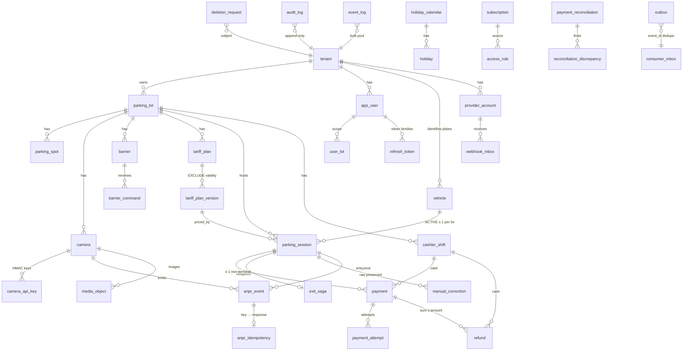

# База данных — фаза 2

**Статус:** 2026-09-19. PostgreSQL 16.2, миграции Alembic `backend/alembic/`, SQL — `backend/alembic/sql/`. Решения: [ADR-08](adr/ADR-08-session-partitioning.md), [ADR-09](adr/ADR-09-idempotency-registry.md), [ADR-02](adr/ADR-02-two-db-pools.md) (роли). Тесты инвариантов уровня БД — `backend/tests/invariants/`, тесты схемы — `backend/tests/db/`.

## 0. Критика черновика v2

Черновик из `docs/prompts/PHASE-02-database.md` §5 применяется без ошибок, но архитектурно не годится как есть. Найденные проблемы и исправления (все — в миграциях 0002–0008):

**Проблема 1: `payment` не связан с `parking_session` FK.** `session_id`/`lot_id` — просто колонки.
Почему сломается: платёж на несуществующую или чужую сессию проходит; при `tenant_id` платежа ≠ tenant сессии RLS покажет платёж не тому tenant; сверка и отчёты по join'у теряют строки.
Исправление: `UNIQUE (tenant_id, lot_id, id)` на `parking_session` (включает ключ партиции) и `FOREIGN KEY (tenant_id, lot_id, session_id) REFERENCES parking_session (tenant_id, lot_id, id)` в `payment`, `exit_saga`, `manual_correction`.

**Проблема 2: межплощадочные ссылки внутри tenant.** `barrier.camera_id → camera (tenant_id, id)` допускает камеру другой площадки того же tenant; у `parking_session.entry_camera_id` FK не было вовсе.
Почему сломается: сессия площадки A с камерой площадки B — отчёты по камерам и здоровье устройств врут, occupancy считается не там.
Исправление: `UNIQUE (tenant_id, lot_id, id)` на `camera` и `barrier`; FK `(tenant_id, lot_id, camera_id)` в `barrier`, `parking_session`, `anpr_event`, `media_object`; FK `(tenant_id, lot_id, barrier_id)` в `barrier_command`.

**Проблема 3: `tariff_plan_version.plan_id REFERENCES tariff_plan (id)` без tenant.** То же у `parking_session.tariff_plan_version_id`.
Почему сломается: версия с `tenant_id` B привязана к плану tenant A → RLS отдаёт её tenant B, расчёт EXIT берёт чужой тариф.
Исправление: `UNIQUE (tenant_id, id)` на `tariff_plan`/`tariff_plan_version`, композитные FK; `created_by` получил FK на `app_user`.

**Проблема 4: `last_used_at` на каждом запросе** (помечено ОТКРЫТО).
Почему сломается: 200 UPDATE/с на `camera_api_key` — WAL, bloat, блокировки строк ключей на горячем пути аутентификации.
Исправление: запись в Redis (`HSET camkey:lastused`), флаш раз в 60 с ролью `app_maintenance`; `app_critical` не имеет UPDATE на эту колонку в горячем пути (колоночный GRANT только `app_bulk`/`app_maintenance`). Добавлен `pepper_version` — без него ротация pepper инвалидирует все ключи разом.

**Проблема 5: `barrier.endpoint` — SSRF** (ОТКРЫТО); `auth_secret_ref NOT NULL` даже для Modbus.
Исправление: `parking_lot.barrier_cidr_allowlist cidr[]` (аллоклист на уровне площадки), `driver` как enum, `auth_secret_ref` NULL-able с `CHECK (driver <> 'HTTP_REST' OR auth_secret_ref IS NOT NULL)`; резолв DNS и блок-лист — в приложении (фаза 4), таблица даёт данные для проверки.

**Проблема 6: `parking_session` не выражает семантику фазы 1.** Нет `exit_kind`, `entry_unknown`/`entry_inferred`, `review_reason`, `closed_reason`, ссылок на события.
Почему сломается: orphan, `EXIT_INFERRED`, ручное закрытие и выезд без въезда неразличимы в отчётах; I-16 не на что опереться.
Исправление: добавлены колонки, `CHECK ck_closed_complete` требует `exit_kind` у CLOSED, `entry_event_id` связывает с неизменяемым `anpr_event`.

**Проблема 7: индексы outbox не соответствуют publisher'у.** `ix_outbox_pending (created_at)` при `ORDER BY id`; `ix_outbox_retry … WHERE status = 'FAILED'`, хотя FAILED — терминальный статус после M попыток; таблица не партиционирована при 2.5 млн строк/сутки.
Исправление: `(id) WHERE status = 'PENDING'`, `(next_retry_at) WHERE status = 'PENDING' AND next_retry_at IS NOT NULL`, партиции по дням с ретеншеном 7 дней дропом, `event_id` для inbox потребителей, `trace_parent`, триггер `NOTIFY outbox_new`.

**Проблема 8: `anpr_idempotency` с `DELETE`-ретеншеном и `result_ref` вместо ответа.**
Почему сломается: 2.5 млн `DELETE` в сутки на самой горячей таблице; по `result_ref` нельзя вернуть *тот же* ответ (I-3 требует идентичный ответ с `barrier_command_id`, `correlation_id`).
Исправление: ADR-09 — партиции по `event_second`, PK `(event_second, idempotency_key)`, колонка `response jsonb`.

**Проблема 9: `audit_log` не принуждает I-15.** `reason` nullable, нет `actor_type`.
Исправление: `actor_type`, `CHECK (actor_type <> 'USER' OR (user_id IS NOT NULL AND length(reason) >= 3))`, `lot_id`/`session_id` для выборок оператора.

**Проблема 10: один `key_version` на два независимых ключа.** HMAC-ключ и DEK ротируются порознь.
Исправление: `hmac_key_version` и `enc_key_version` в `vehicle`, `anpr_event`, `access_rule`, `tenant`; `anonymized_at` для privacy.

**Проблема 11: `payment` без смены, предоплаты и основания льготы.** `ck_cash_has_operator` есть, но наличные без смены не сверяются (фаза 5 §3); нет `paid_until` (A-11), `source_id`, `provider`, `saga_id`; enum методов не различает бесплатные проезды.
Исправление: `cashier_shift`, `shift_id` обязателен для CASH, `paid_until`, `source_id` с `CHECK ck_privilege_source`, `payment_method` дополнен `WHITELIST`/`GRACE`, `CHECK ck_provider_methods`. Триггер I-6 из комментария стал кодом: `app.payment_guard` + запрет DELETE + `app.refund_guard`/`app.refund_settle`.

**Проблема 12: RLS не описан, а «pre-tenant» запросы не имеют пути.** Логин по email, аутентификация камеры по префиксу и вебхук по merchant_id происходят до того, как tenant известен.
Почему сломается: либо политики делаются fail-open (`current_tenant() IS NULL → всё видно`) — и забытый `SET LOCAL` раскрывает все таблицы, либо приложение ходит владельцем.
Исправление: политики строго fail-closed; три `SECURITY DEFINER`-функции `app.lookup_user_by_email`, `app.lookup_camera_keys`, `app.lookup_provider_account` — единственный кросс-tenant путь, узкий и проверяемый.

**Проблема 13: партиции и RLS.** Политики на родителе не защищают прямой доступ к партиции.
Исправление: партициям права не выдаются, `ALTER DEFAULT PRIVILEGES` не используется; тест `test_direct_partition_access_is_denied`.

**Проблема 14: типы под объёмы.** `anpr_event`, `barrier_command`, `payment_attempt`, `media_object`, `event_log`, `audit_log` (суммарно > 10 млн строк/сутки) в черновике либо отсутствовали, либо не партиционированы.
Исправление: RANGE-партиции (см. §3), PK всегда включает ключ партиции; `outbox.id`/`audit_log.id` — `bigint`.

**Проблема 15: `pgcrypto` не нужен.** `gen_random_uuid()` — в ядре с PG 13, HMAC/AES считаются в приложении. Расширение убрано; остаётся только `btree_gist` (I-12).

**Проблема 16: индекс `ix_session_lookup (lot_id, vehicle_id, status)` избыточен.** Горячий путь обслуживает partial unique `uq_session_one_active`; для истории машины нужен `(vehicle_id, entry_time DESC)`, для ленты — `(lot_id, entry_time DESC, id DESC)` под курсор.

Проверки из §0, давшие «всё в порядке»: циклических FK нет (`subscription.payment_id` намеренно без FK — платёж создаётся в фазе 5, иначе цикл `payment → session → … → access_rule → subscription → payment`); открытого номера нет ни в одной колонке (тест `tests/db/test_no_plaintext_plate.py`); каждая tenant-owned таблица имеет `tenant_id` и RLS (тест `test_every_tenant_table_has_rls_and_both_policies`).

## 1. Решения фазы

### 1.1 Партиционирование `parking_session` против I-1 — ADR-08

Эксперимент воспроизведён на PostgreSQL 16.2 (`backend/scripts/experiments/01_partition_unique.sql`, вывод в `.out`):

```
=== partial UNIQUE на HASH-партиционированной таблице, ключ партиционирования включён ===
CREATE UNIQUE INDEX uq_active ON ps (lot_id, vehicle_id) WHERE status = 'ACTIVE';
CREATE INDEX
=== принуждение ===
INSERT ... 'ACTIVE'   → INSERT 0 1
INSERT ... 'ACTIVE'   → ERROR:  duplicate key value violates unique constraint "ps_0_lot_id_vehicle_id_idx"
INSERT ... 'CLOSED'   → INSERT 0 1
INSERT ... 'CLOSED'   → INSERT 0 1
 status | count
--------+-------
 ACTIVE |     1
 CLOSED |     2
=== то же без ключа партиционирования ===
ERROR:  unique constraint on partitioned table must include all partitioning columns
DETAIL:  UNIQUE constraint on table "ps" lacks column "lot_id" which is part of the partition key.
=== EXCLUDE на партиционированной таблице ===
ERROR:  exclusion constraints are not supported on partitioned tables
```

Выбран вариант A (HASH по `lot_id`, 32 партиции). Ретеншен 7 лет делает невозможность дропа по времени несущественной; удаление ПДн — анонимизация.

### 1.2 Уникальность идемпотентности против партиционирования — ADR-09

Эксперимент (та же выдача) подтверждает тезис черновика: на партициях по `event_time` глобальный `UNIQUE (idempotency_key)` невозможен, а `UNIQUE (idempotency_key, event_time)` пропускает дубликат через границу партиций (`count = 2`).

Рассуждение черновика **подтверждено с уточнением**: (а) верхняя граница «дубликат не придёт через неделю» вытекает не из клокового разбега (он лишь помечает событие), а из окна отказа replay `lot.late_event_window_hours` (24 ч, A-13) — всё старше отклоняется до проверки идемпотентности, поэтому ретеншен 7 суток > 24 ч + skew достаточен; (б) непартиционированная таблица с `DELETE` не нужна: раз секунда события входит в формулу ключа, партиционирование по `event_second` даёт глобальную уникальность и ретеншен дропом партиций.

### 1.3 RLS: как приложение представляется базе

| Вопрос | Решение |
|---|---|
| Роль приложения | три `LOGIN NOBYPASSRLS NOINHERIT` роли: `app_critical` (`synchronous_commit = remote_apply`), `app_bulk` (`off`), `app_maintenance` (`on`) — ADR-02. Владелец схемы (`postgres`/migrator) приложением не используется; проверка DSN на старте — фаза 3 |
| Как проставляется tenant | `set_config('app.current_tenant_id', $1, true)` ≡ `SET LOCAL` в каждой транзакции — `parking.platform.db.tenant.tenant_transaction()` |
| Отсутствие переменной | `app.current_tenant()` → NULL → `tenant_id = NULL` ложно → ни строки на чтение, `WITH CHECK` отвергает запись (тест `test_without_tenant_context_nothing_is_visible_or_writable`) |
| Фоновые джобы с несколькими tenant | `app_maintenance` с политикой `USING (true)` на каждой таблице — явная, не BYPASSRLS; используется publisher'ом, ретеншеном, флашем heartbeat, поиском просроченных саг. Бизнес-шаг (сага, закрытие сессии) выполняется уже `app_critical` с tenant из строки |
| Pre-tenant запросы | `SECURITY DEFINER` функции `app.lookup_user_by_email`, `app.lookup_camera_keys`, `app.lookup_provider_account`; `EXECUTE` только у `app_critical` |
| Пулер | `SET LOCAL` внутри транзакции безопасен под PgBouncer transaction pooling; `SET` вне транзакции запрещён (правило кода, проверка — фаза 9 под реальным пулером). Долговечность — настройка роли, а не сессии |
| Партиции | без прав; политики на родителе; `ALTER DEFAULT PRIVILEGES` не используется |
| Два рубежа | репозиторий всегда фильтрует `tenant_id` (тест под владельцем, где RLS не действует) + RLS (тест под ролью с запросом без фильтра) — `test_repository_filters_tenant_independently_of_rls` |

### 1.4 Шифрование номеров

- `plate_hash = HMAC-SHA256(HMACK_tenant[v], normalize(plate))` — детерминирован, по нему индекс и поиск; `hmac_key_version` в строке.
- `plate_encrypted = nonce(12) ‖ AES-256-GCM(DEK_tenant[v], plate, AAD = tenant_id ‖ enc_key_version) ‖ tag(16)` — недетерминирован, `CHECK (octet_length >= 28)`; AAD привязывает шифртекст к tenant и версии: перенос между tenant'ами не расшифруется.
- Ключи — в Vault (Transit-обёртка, KV по `tenant.crypto_key_ref`), в БД только `enc_key_version`/`hmac_key_version` (A-05).
- Ротация: `tenant.*_key_version += 1`; джоб `maintenance` перешифровывает строки с меньшей версией батчами; в переходный период поиск — `plate_hash IN (HMAC_v_new, HMAC_v_old)`.
- Нормализация — доменный слой (фаза 3.1, `PlateNumber`), выполняется **до** хеширования: `upper()`; удаление пробелов, дефисов, точек; транслитерация кириллических омоглифов `АВЕКМНОРСТУХ → ABEKMHOPCTYX`; распознавание формата: `UZ_STANDARD` `^\d{2}[A-Z]\d{3}[A-Z]{2}$` (`01A123AA`), `UZ_LEGAL` `^\d{2}\d{3}[A-Z]{3}$` (`01123AAA`), иначе `FOREIGN` (буквенно-цифровая строка 4–12 символов как есть). Тест-векторы: `01 A 123 AA`, `01a123aa`, `01А123АА` (кириллица) → один хеш; `01-A-123-AA` → тот же; `O1A123AA` (буква O вместо нуля) → другой хеш, коррекция по позиции **не** делается — это работа оператора (I-16), а не тихая подмена.

## 2. ERD



Все связи «дочерняя → родительская» — композитные FK с `tenant_id` (и `lot_id`, где есть площадка): чужой tenant физически невозможен.

## 3. Таблицы, партиционирование, ретеншен

| Таблица | Контекст | Партиции | Ретеншен | RLS | Права `app_critical` |
|---|---|---|---|---|---|
| `tenant`, `parking_lot`, `parking_spot` | Tenancy | — | навсегда | по `id`/`tenant_id` | S/I/U |
| `app_user`, `user_lot`, `refresh_token` | Identity | — | refresh: `DELETE` истёкших (`app_maintenance`, по индексу `expires_at`, малый объём) | да | S/I/U |
| `login_attempt` | Identity | — | 30 дней, DELETE (`app_maintenance`) | нет (без ПДн) | S/I |
| `camera`, `camera_api_key`, `barrier` | Devices | — | навсегда | да | S/I/U |
| `barrier_command` | Devices | RANGE месяц | 13 мес, дроп | да | S/I/U |
| `tariff_plan`, `holiday_calendar`, `holiday` | Tariff | — | навсегда | да | S/I/U (+D holiday) |
| `tariff_plan_version` | Tariff | — (EXCLUDE) | навсегда | да | **S/I** |
| `access_rule`, `subscription` | Access | — | навсегда (отзыв — `revoked_at`) | да | S/I/U |
| `vehicle` | Parking | — | 7 лет; ПДн — анонимизация | да | S/I/U |
| `parking_session` | Parking | HASH 32 по `lot_id` | 7 лет | да | S/I/U |
| `exit_saga` | Parking | — | 90 дней после терминала, DELETE (`maintenance`) | да | S/I/U |
| `manual_correction` | Parking | — | 7 лет | да | **S/I** |
| `anpr_event` | ANPR | RANGE месяц по `event_time` | 400 дней, дроп (A-18) | да | **S/I** |
| `anpr_idempotency` | ANPR | RANGE день по `event_second` | 7 дней, дроп | да | **S/I** |
| `provider_account`, `cashier_shift`, `payment`, `refund`, `payment_reconciliation`, `reconciliation_discrepancy`, `webhook_inbox` | Billing | — | 7 лет | да | S/I/U (payment: триггеры I-6) |
| `payment_attempt` | Billing | RANGE месяц | 7 лет (партиции не дропаются) | да | S/I/U |
| `audit_log` | Audit | RANGE месяц | 5 лет, дроп | да | **S/I** |
| `event_log` | Audit | RANGE месяц | 3 года, дроп | да | **S/I** (`app_bulk` I) |
| `outbox` | platform | RANGE день | 7 дней, дроп | да | S/I (`maintenance` U) |
| `consumer_inbox` | platform | RANGE день по `event_created_at` | 7 дней, дроп | нет (технические данные) | S/I |
| `media_object` | Media | RANGE месяц | 4 мес, дроп (MinIO lifecycle 90 д) | да | S/I/U |
| `deletion_request` | Privacy | — | навсегда (юридический след) | да | S/I/U |

Партициями управляют `app.ensure_range_partitions(parent, 'day'|'month', behind, ahead)` и `app.drop_range_partitions(parent, retain)` — `SECURITY DEFINER`, `EXECUTE` у `app_maintenance`; джоб `maintenance` вызывает их ежечасно, метрика `partition_coverage_seconds` из `app.partition_coverage()`, алерт при покрытии < 24 ч. Вставка вне существующих партиций падает с ошибкой, а не в DEFAULT-партицию — намеренно (DEFAULT мешает создавать новые партиции и прячет проблему).

Ретеншен-джоб идемпотентен (функции ничего не делают повторно), наблюдаем (возвращают счётчики → метрика + лог) и не выполняет `DELETE` там, где возможен дроп партиции.

## 4. Индексы под 9 запросов §3

| # | Запрос | Индекс(ы) | Почему этого достаточно |
|---|---|---|---|
| 1 | активная сессия по `(tenant_id, lot_id, plate_hash)` | `uq_vehicle_plate (tenant_id, plate_hash)` → `uq_session_one_active (lot_id, vehicle_id) WHERE ACTIVE` | два точечных Index Scan; `lot_id` = константа → pruning в одну партицию |
| 2 | blacklist с `lot_id IS NULL` как глобальным | `ix_access_lookup (tenant_id, plate_hash) INCLUDE (kind, lot_id, validity, discount_percent, source_id) WHERE revoked_at IS NULL` | одна точка входа по номеру; `lot IS NULL OR lot = $1`, `validity @> $at`, `kind` фильтруются по INCLUDE-колонкам (Index Only Scan) |
| 3 | whitelist / VIP / subscription со сроком | тот же | ADR-03: один запрос на все виды, приоритет — в коде |
| 4 | идемпотентность | PK `(event_second, idempotency_key)` на дневных партициях | `event_second` в условии → одна партиция, точечный Index Scan |
| 5 | outbox `FOR UPDATE SKIP LOCKED` | `ix_outbox_pending (id) WHERE status = 'PENDING'` (на каждой дневной партиции) | Merge Append по партициям в порядке `id`, `LIMIT` останавливает рано; PENDING-строки живут в 1–2 последних партициях |
| 6 | occupancy | `uq_session_one_active` | Index Only Scan по partial-индексу партиции площадки |
| 7 | дневной отчёт по способам оплаты | `ix_payment_report (tenant_id, paid_at) INCLUDE (method, amount, lot_id) WHERE status = 'PAID'` | диапазон по `paid_at`, агрегат по INCLUDE без heap |
| 8 | лента оператора с курсором | `ix_session_lot_feed (lot_id, entry_time DESC, id DESC)` | row-comparison `(entry_time, id) < ($t, $id)` + `ORDER BY … DESC LIMIT 50` = один проход индекса, без OFFSET |
| 9 | камеры без heartbeat | `ix_camera_stale (last_heartbeat_at NULLS FIRST) WHERE active` | диапазон «старше порога» + NULL в начале индекса |

Фактические планы — §5 (данные: 300 000 `vehicle`, 1 000 000 `parking_session`, 1 000 000 `anpr_event`/`anpr_idempotency`, ~985 000 `payment`, 200 100 `outbox`, 100 004 `access_rule`, 30 006 `camera`).

## 5. EXPLAIN (ANALYZE, BUFFERS) на 1 млн сессий

Полный вывод — `docs/database/explain.out`, скрипт — `backend/scripts/explain_queries.sql`, данные — `backend/scripts/load_1m.sql` (лог `docs/database/load_1m.out`). Ни одного Seq Scan по таблице с данными; единственные `Seq Scan` в полной выдаче — на пустых партициях outbox (0 страниц, cost 0.00), которые PostgreSQL печатает так для любой пустой relation.

=== 1. Активная сессия по (tenant_id, lot_id, plate_hash) — горячий путь EXIT ===
```
 Nested Loop  (cost=0.70..16.76 rows=1 width=24) (actual time=0.555..0.557 rows=1 loops=1)
   Buffers: shared hit=3 read=4 written=3
   ->  Index Scan using uq_vehicle_plate on vehicle v  (cost=0.42..8.44 rows=1 width=16) (actual time=0.406..0.407 rows=1 loops=1)
         Index Cond: ((tenant_id = '00000000-0000-4000-8000-0000000000a1'::uuid) AND (plate_hash = '\x46f417c783e25675c947399657ed4774500e3c22968f8dba9faadce191b2b48d'::bytea))
         Buffers: shared hit=1 read=3 written=2
   ->  Index Scan using parking_session_p11_lot_id_vehicle_id_idx on parking_session_p11 s  (cost=0.28..8.30 rows=1 width=40) (actual time=0.144..0.145 rows=1 loops=1)
         Index Cond: ((lot_id = '00000000-0000-4000-8000-00000000a101'::uuid) AND (vehicle_id = v.id))
         Filter: (tenant_id = '00000000-0000-4000-8000-0000000000a1'::uuid)
         Buffers: shared hit=2 read=1 written=1
 Planning:
   Buffers: shared hit=20 read=1 written=1
 Planning Time: 0.621 ms
 Execution Time: 0.579 ms
```

=== 2. Blacklist по (tenant_id, plate_hash), lot_id IS NULL как глобальное правило ===
```
 Index Scan using ix_access_lookup on access_rule  (cost=0.42..8.45 rows=1 width=53) (actual time=0.350..0.351 rows=1 loops=1)
   Index Cond: ((tenant_id = '00000000-0000-4000-8000-0000000000a1'::uuid) AND (plate_hash = '\x021bbd75cf6530bd40f4ab8b131600e0188f4a8c51c9ebe112daef408a498e56'::bytea))
   Filter: (((lot_id IS NULL) OR (lot_id = '00000000-0000-4000-8000-00000000a101'::uuid)) AND (kind = 'BLACKLIST'::access_kind) AND (validity @> now()))
   Buffers: shared read=4 written=4
 Planning:
   Buffers: shared hit=83 read=6 written=6
 Planning Time: 0.886 ms
 Execution Time: 0.369 ms
```

=== 3. Все виды правил (whitelist, VIP, subscription) одним запросом с проверкой срока ===
```
 Index Only Scan using ix_access_lookup on access_rule  (cost=0.42..4.45 rows=1 width=38) (actual time=0.132..0.133 rows=1 loops=1)
   Index Cond: ((tenant_id = '00000000-0000-4000-8000-0000000000a1'::uuid) AND (plate_hash = '\x021bbd75cf6530bd40f4ab8b131600e0188f4a8c51c9ebe112daef408a498e56'::bytea))
   Filter: (((lot_id IS NULL) OR (lot_id = '00000000-0000-4000-8000-00000000a101'::uuid)) AND (validity @> now()))
   Heap Fetches: 0
   Buffers: shared hit=3 read=1 written=1
 Planning:
   Buffers: shared hit=6
 Planning Time: 0.111 ms
 Execution Time: 0.147 ms
```

=== 4. Идемпотентность по ключу (с секундой события → одна партиция) ===
```
 Index Scan using anpr_idempotency_20260720_pkey on anpr_idempotency_20260720 anpr_idempotency  (cost=0.28..8.30 rows=1 width=88) (actual time=0.178..0.179 rows=1 loops=1)
   Index Cond: ((event_second = '2026-07-21 02:47:08+05'::timestamp with time zone) AND (idempotency_key = '\xfea9ba6f9f592fa4b62751fc95596e3de0f3dfa9d8e4bcaff400dca2adc522a5'::bytea))
   Buffers: shared hit=1 read=2 written=2
 Planning:
   Buffers: shared hit=6
 Planning Time: 0.114 ms
 Execution Time: 0.188 ms
```

=== 5. Outbox: неопубликованные с FOR UPDATE SKIP LOCKED ===
```
  … 4 пустые (0 страниц) партиции опущены: для пустой relation планировщик печатает Seq Scan cost=0.00 …
 Limit  (cost=45.08..46.37 rows=103 width=48) (actual time=0.178..0.286 rows=100 loops=1)
   Buffers: shared hit=213
   ->  LockRows  (cost=45.08..46.37 rows=103 width=48) (actual time=0.177..0.274 rows=100 loops=1)
         Buffers: shared hit=213
         ->  Sort  (cost=45.08..45.34 rows=103 width=48) (actual time=0.154..0.162 rows=100 loops=1)
               Sort Key: outbox.id
               Sort Method: quicksort  Memory: 32kB
               Buffers: shared hit=13
               ->  Append  (cost=0.00..41.64 rows=103 width=48) (actual time=0.046..0.113 rows=100 loops=1)
                     Buffers: shared hit=10
                     ->  Index Scan using outbox_20260912_id_idx on outbox_20260912 outbox_2  (cost=0.12..4.15 rows=1 width=44) (actual time=0.003..0.003 rows=0 loops=1)
                           Filter: ((status = 'PENDING'::outbox_status) AND ((next_retry_at IS NULL) OR (next_retry_at <= now())))
                           Buffers: shared hit=1
                     ->  Index Scan using outbox_20260913_id_idx on outbox_20260913 outbox_3  (cost=0.12..4.15 rows=1 width=44) (actual time=0.003..0.003 rows=0 loops=1)
                           Filter: ((status = 'PENDING'::outbox_status) AND ((next_retry_at IS NULL) OR (next_retry_at <= now())))
                           Buffers: shared hit=1
                     ->  Index Scan using outbox_20260914_id_idx on outbox_20260914 outbox_4  (cost=0.12..4.15 rows=1 width=44) (actual time=0.002..0.002 rows=0 loops=1)
                           Filter: ((status = 'PENDING'::outbox_status) AND ((next_retry_at IS NULL) OR (next_retry_at <= now())))
                           Buffers: shared hit=1
                     ->  Index Scan using outbox_20260915_id_idx on outbox_20260915 outbox_5  (cost=0.12..4.15 rows=1 width=44) (actual time=0.002..0.002 rows=0 loops=1)
                           Filter: ((status = 'PENDING'::outbox_status) AND ((next_retry_at IS NULL) OR (next_retry_at <= now())))
                           Buffers: shared hit=1
                     ->  Index Scan using outbox_20260916_id_idx on outbox_20260916 outbox_6  (cost=0.12..4.15 rows=1 width=44) (actual time=0.003..0.003 rows=0 loops=1)
                           Filter: ((status = 'PENDING'::outbox_status) AND ((next_retry_at IS NULL) OR (next_retry_at <= now())))
                           Buffers: shared hit=1
                     ->  Index Scan using outbox_20260917_id_idx on outbox_20260917 outbox_7  (cost=0.12..4.15 rows=1 width=44) (actual time=0.001..0.001 rows=0 loops=1)
                           Filter: ((status = 'PENDING'::outbox_status) AND ((next_retry_at IS NULL) OR (next_retry_at <= now())))
                           Buffers: shared hit=1
                     ->  Index Scan using outbox_20260918_id_idx on outbox_20260918 outbox_8  (cost=0.14..16.23 rows=93 width=44) (actual time=0.008..0.061 rows=100 loops=1)
                           Filter: ((status = 'PENDING'::outbox_status) AND ((next_retry_at IS NULL) OR (next_retry_at <= now())))
                           Buffers: shared hit=4
 Planning:
   Buffers: shared hit=1342 read=2 written=2
 Planning Time: 6.571 ms
 Execution Time: 0.390 ms
```

=== 6. Occupancy: число активных сессий площадки ===
```
 Aggregate  (cost=125.40..125.41 rows=1 width=8) (actual time=1.172..1.172 rows=1 loops=1)
   Buffers: shared hit=1 read=6 written=5
   ->  Index Only Scan using parking_session_p11_lot_id_entry_time_idx on parking_session_p11 parking_session  (cost=0.28..113.26 rows=4856 width=0) (actual time=0.126..0.815 rows=5000 loops=1)
         Index Cond: (lot_id = '00000000-0000-4000-8000-00000000a101'::uuid)
         Heap Fetches: 0
         Buffers: shared hit=1 read=6 written=5
 Planning:
   Buffers: shared hit=7
 Planning Time: 0.263 ms
 Execution Time: 1.191 ms
```

=== 7. Дневной отчёт: платежи tenant за диапазон дат по способу оплаты ===
```
 HashAggregate  (cost=827.43..827.46 rows=2 width=44) (actual time=9.013..9.015 rows=2 loops=1)
   Group Key: method
   Batches: 1  Memory Usage: 24kB
   Buffers: shared read=134 written=87
   ->  Index Only Scan using ix_payment_report on payment  (cost=0.43..748.68 rows=10500 width=12) (actual time=0.531..6.742 rows=10941 loops=1)
         Index Cond: ((tenant_id = '00000000-0000-4000-8000-0000000000a1'::uuid) AND (paid_at >= (now() - '30 days'::interval)) AND (paid_at < (now() - '29 days'::interval)))
         Heap Fetches: 0
         Buffers: shared read=134 written=87
 Planning:
   Buffers: shared hit=155 read=12 written=12
 Planning Time: 2.584 ms
 Execution Time: 9.060 ms
```

=== 8. Лента оператора: 50 сессий площадки после курсора (entry_time, id) ===
```
 Limit  (cost=0.42..6.58 rows=50 width=28) (actual time=0.014..7.178 rows=50 loops=1)
   Buffers: shared hit=13 read=41 written=28
   ->  Index Scan using parking_session_p11_lot_id_entry_time_id_idx on parking_session_p11 parking_session  (cost=0.42..40937.88 rows=332348 width=28) (actual time=0.013..7.156 rows=50 loops=1)
         Index Cond: ((lot_id = '00000000-0000-4000-8000-00000000a101'::uuid) AND (ROW(entry_time, id) < ROW('2026-09-19 01:23:08.811205+05'::timestamp with time zone, '953b504b-bf3f-42a3-ad48-dcc84a7033e7'::uuid)))
         Buffers: shared hit=13 read=41 written=28
 Planning:
   Buffers: shared hit=7
 Planning Time: 0.309 ms
 Execution Time: 7.232 ms
```

=== 9. Камеры без heartbeat дольше порога ===
```
 Bitmap Heap Scan on camera  (cost=11.05..516.86 rows=309 width=40) (actual time=0.136..0.692 rows=306 loops=1)
   Recheck Cond: (((last_heartbeat_at IS NULL) AND active) OR ((last_heartbeat_at < (now() - '00:10:00'::interval)) AND active))
   Filter: ((last_heartbeat_at IS NULL) OR (last_heartbeat_at < (now() - '00:10:00'::interval)))
   Heap Blocks: exact=301
   Buffers: shared hit=303 read=2 written=1
   ->  BitmapOr  (cost=11.05..11.05 rows=309 width=0) (actual time=0.091..0.092 rows=0 loops=1)
         Buffers: shared hit=2 read=2 written=1
         ->  Bitmap Index Scan on ix_camera_stale  (cost=0.00..4.33 rows=6 width=0) (actual time=0.062..0.062 rows=6 loops=1)
               Index Cond: (last_heartbeat_at IS NULL)
               Buffers: shared read=2 written=1
         ->  Bitmap Index Scan on ix_camera_stale  (cost=0.00..6.56 rows=303 width=0) (actual time=0.029..0.029 rows=300 loops=1)
               Index Cond: (last_heartbeat_at < (now() - '00:10:00'::interval))
               Buffers: shared hit=2
 Planning:
   Buffers: shared hit=14 read=4 written=2
 Planning Time: 0.753 ms
 Execution Time: 0.734 ms
```

## 6. Локальная среда

Docker и root на машине разработки недоступны (A-19): PostgreSQL 16.2 — пакет `pgserver`, `btree_gist` собран из contrib через `zig cc`, Python 3.12 — через `uv`. Инструкция — `backend/README.md`. Тесты по умолчанию используют этот кластер (`backend/.pgdata`, БД `parking_test` пересоздаётся на каждую сессию pytest); в CI задаётся `PARKING_TEST_DSN` на кластер testcontainers — код тестов одинаков.

## 7. Gate фазы 2

| Пункт | Артефакт |
|---|---|
| Разбор черновика выведен, проблемы исправлены в DDL | §0, миграции `backend/alembic/sql/0002…0008_up.sql` |
| `alembic upgrade head` на пустой БД | ниже, `docs/database/gate-alembic.out` |
| `downgrade base && upgrade head` | там же |
| Эксперимент §1.1, ADR | §1.1, `backend/scripts/experiments/01_partition_unique.{sql,out}`, ADR-08, ADR-09 |
| Сид + 1 млн сессий | `backend/scripts/seed_dev.sql`, `backend/scripts/load_1m.sql`, `docs/database/load_1m.out` |
| EXPLAIN по 9 запросам без Seq Scan | §5, `docs/database/explain.out` |
| Тест изоляции tenant через репозиторий и прямой SQL | `tests/invariants/test_i02_tenant_isolation.py::test_repository_filters_tenant_independently_of_rls`, `::test_raw_sql_under_tenant_b_does_not_see_tenant_a` |
| Тест: две параллельные транзакции не создают две ACTIVE | `tests/invariants/test_i01_one_active_session.py` |
| Тест: UPDATE payment PAID отклонён | `tests/invariants/test_i06_payment_immutable.py` |
| Тест: DELETE из audit_log отклонён | `tests/invariants/test_i11_audit_append_only.py` |
| Тест: пересекающиеся версии тарифа отклонены | `tests/invariants/test_i12_tariff_no_overlap.py` |
| grep схемы: нет колонки с открытым номером | `tests/db/test_no_plaintext_plate.py` + grep ниже |
| `docs/DATABASE.md`: ERD, ретеншен, партиционирование, RLS | §2, §3, §1.3 |

Тест I-3 (`test_i03_idempotency.py`) — сверх обязательного списка: 100 параллельных одинаковых ключей → один победитель, lookup прунится в одну партицию. Тест `test_maintenance_role_can_manage_partitions_but_not_critical` нашёл реальную дыру: `SECURITY DEFINER`-функции партиций по умолчанию исполняемы `PUBLIC` — исправлено `REVOKE … FROM PUBLIC` в 0005.

### Вывод команд

```
$ uv run alembic downgrade base
INFO  [alembic.runtime.migration] Context impl PostgresqlImpl.
INFO  [alembic.runtime.migration] Will assume transactional DDL.
INFO  [alembic.runtime.migration] Running downgrade 0008 -> 0007, RLS-политики на все tenant-owned таблицы и права ролей app_critical / app_bulk / app_maintenance
INFO  [alembic.runtime.migration] Running downgrade 0007 -> 0006, Audit, event_log, outbox (по дням, NOTIFY), consumer_inbox, media_object, deletion_request
INFO  [alembic.runtime.migration] Running downgrade 0006 -> 0005, Billing: provider_account, cashier_shift, payment (триггер I-6), payment_attempt, refund (контроль суммы), сверка, webhook_inbox
INFO  [alembic.runtime.migration] Running downgrade 0005 -> 0004, Parking и ANPR: vehicle, parking_session (HASH 32), anpr_event, anpr_idempotency, exit_saga, manual_correction
INFO  [alembic.runtime.migration] Running downgrade 0004 -> 0003, Tariff и Access Control: tariff_plan, tariff_plan_version (EXCLUDE), holiday_calendar, holiday, access_rule, subscription
INFO  [alembic.runtime.migration] Running downgrade 0003 -> 0002, Devices: camera, camera_api_key, barrier, barrier_command (партиции по месяцам)
INFO  [alembic.runtime.migration] Running downgrade 0002 -> 0001, Tenancy и Identity: tenant, parking_lot, parking_spot, app_user, user_lot, refresh_token, login_attempt
INFO  [alembic.runtime.migration] Running downgrade 0001 -> , Фундамент: btree_gist, схема app, роли, enum-типы, служебные функции
$ psql -c "\dt" | wc -l  (таблиц после downgrade base, включая alembic_version)
1
$ uv run alembic upgrade head
INFO  [alembic.runtime.migration] Context impl PostgresqlImpl.
INFO  [alembic.runtime.migration] Will assume transactional DDL.
INFO  [alembic.runtime.migration] Running upgrade  -> 0001, Фундамент: btree_gist, схема app, роли, enum-типы, служебные функции
INFO  [alembic.runtime.migration] Running upgrade 0001 -> 0002, Tenancy и Identity: tenant, parking_lot, parking_spot, app_user, user_lot, refresh_token, login_attempt
INFO  [alembic.runtime.migration] Running upgrade 0002 -> 0003, Devices: camera, camera_api_key, barrier, barrier_command (партиции по месяцам)
INFO  [alembic.runtime.migration] Running upgrade 0003 -> 0004, Tariff и Access Control: tariff_plan, tariff_plan_version (EXCLUDE), holiday_calendar, holiday, access_rule, subscription
INFO  [alembic.runtime.migration] Running upgrade 0004 -> 0005, Parking и ANPR: vehicle, parking_session (HASH 32), anpr_event, anpr_idempotency, exit_saga, manual_correction
INFO  [alembic.runtime.migration] Running upgrade 0005 -> 0006, Billing: provider_account, cashier_shift, payment (триггер I-6), payment_attempt, refund (контроль суммы), сверка, webhook_inbox
INFO  [alembic.runtime.migration] Running upgrade 0006 -> 0007, Audit, event_log, outbox (по дням, NOTIFY), consumer_inbox, media_object, deletion_request
INFO  [alembic.runtime.migration] Running upgrade 0007 -> 0008, RLS-политики на все tenant-owned таблицы и права ролей app_critical / app_bulk / app_maintenance
$ uv run alembic downgrade -1 && uv run alembic upgrade head
INFO  [alembic.runtime.migration] Context impl PostgresqlImpl.
INFO  [alembic.runtime.migration] Will assume transactional DDL.
INFO  [alembic.runtime.migration] Running downgrade 0008 -> 0007, RLS-политики на все tenant-owned таблицы и права ролей app_critical / app_bulk / app_maintenance
INFO  [alembic.runtime.migration] Context impl PostgresqlImpl.
INFO  [alembic.runtime.migration] Will assume transactional DDL.
INFO  [alembic.runtime.migration] Running upgrade 0007 -> 0008, RLS-политики на все tenant-owned таблицы и права ролей app_critical / app_bulk / app_maintenance
$ uv run alembic current
INFO  [alembic.runtime.migration] Context impl PostgresqlImpl.
INFO  [alembic.runtime.migration] Will assume transactional DDL.
0008 (head)
$ psql: таблицы/партиции/политики
tables: 38, partitions: 68
rls policies: 70
tables with RLS: 35
```

```
$ grep -inE "plate" alembic/sql/*_up.sql | grep -vE "plate_hash|plate_encrypted|plate_format|corrected_plate_encrypted|subject_plate_hash|комментарии"
(пусто — ни одной колонки с открытым номером)
```

Общий gate CORE §13 (`docs/database/gate-core.out`):

```
$ uv run ruff check . && uv run ruff format --check .
All checks passed!
34 files already formatted
$ uv run mypy --strict src/
Success: no issues found in 8 source files
$ uv run pytest -q
........................................                                 [100%]
40 passed in 16.56s
$ uv run alembic upgrade head && uv run alembic downgrade -1 && uv run alembic upgrade head
INFO  [alembic.runtime.migration] Running downgrade 0008 -> 0007, RLS-политики на все tenant-owned таблицы и права ролей app_critical / app_bulk / app_maintenance
INFO  [alembic.runtime.migration] Running upgrade 0007 -> 0008, RLS-политики на все tenant-owned таблицы и права ролей app_critical / app_bulk / app_maintenance
0008 (head)
```

Полный прогон pytest — `docs/database/gate-pytest.out`: `40 passed in 16.06s`.
